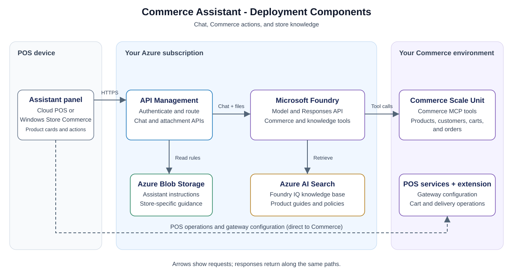

# Commerce Assistant for Dynamics 365 Commerce

Help store associates find products, compare options, and build a customer's order
through conversation in **Cloud POS** or **Windows Store Commerce**.

[Prepare the sample](#prepare-the-sample) | [Install in 3 steps](#install-in-3-steps) |
[Use the assistant](docs/using-commerce-assistant.md) | [Disclaimer](#disclaimer)

## Table of contents

**For users**

- [Why use it](#why-use-it)
- [What it does](#what-it-does)
- [Prepare the sample](#prepare-the-sample)
- [Install in 3 steps](#install-in-3-steps)
- [Manage your assistant](#manage-your-assistant)
- [Disclaimer](#disclaimer)

**Technical details**

- [How it works](#how-it-works)
- [Security](#security)
- [Technology stack](#technology-stack)
- [Package contents](#package-contents)
- [License](#license)

---

## Why use it

- **Help customers without leaving POS.** Ask product questions alongside the current sale.
- **Explain the options.** Review product recommendations and compare alternatives with the customer.
- **Build the basket.** Add selected products, explore related items, or enter a customer's item list.
- **Use your store's guidance.** Add product guides and policies so associates can ask about them in chat.

## What it does

| Task | What the associate can do |
| --- | --- |
| Find and compare products | Describe what the customer needs, review product cards, choose variants, and compare options. |
| Build a sale | Add products to the sale and review suggestions for the current cart. |
| Prepare a customer order | Ask for help with customer-order and shipping tasks. |
| Enter a counter order | Paste item IDs and quantities, or add an item list from a photo. |
| Ask about store information | Ask questions using the product guides and policies you provide. |
| Use voice and attachments | Speak a request or attach a file when supported by the browser and configured model. |

Available actions depend on your Commerce configuration, channel data, and model capabilities.
See the [usage guide](docs/using-commerce-assistant.md) for examples.

## Prepare the sample

1. Use your existing clone, or [clone this repository](https://github.com/microsoft/Dynamics-365-FastTrack-Implementation-Assets).
2. Open `Agents\AI ERP Agents\Commerce Assistant`. If the build reports Windows path-length errors, copy this folder to a shorter path such as `C:\CommerceAssistant` and retry.
3. Keep the `AzureResources` and `Extensions` folders together. Follow the installation guides below to deploy and build them.

## Install in 3 steps

Start with a nonproduction Commerce environment, Commerce MCP enabled, an activated POS
device, and a signed-in associate. The Azure setup requires permission to create
resources and assign roles; the POS build requires Windows development tools and
Commerce SDK **9.61** packages matching your target release.

Follow the guides **in order**:

| Step | Guide | What you do |
| --- | --- | --- |
| 1 | [Deploy the Azure resources](AzureResources/README.md) | Run one deployment command, enter your environment values, and save the assistant endpoint. |
| 2 | [Build and install the POS extension](Extensions/README.md) | Run one build command with that endpoint, deploy the CSU ZIP, and install the Windows extension if needed. |
| 3 | [Configure and try the assistant](docs/using-commerce-assistant.md) | Add your guidance, open chat in POS, and try the store scenarios. |

> Cloud POS needs the CSU package. Windows Store Commerce needs both the CSU package
> and the Windows extension installer.

## Manage your assistant

| What you want to change | Guide |
| --- | --- |
| Tone, rules, and task guidance | [Update the assistant instructions](AzureResources/docs/update-assistant-instructions.md) |
| Product guides, policies, and other documents | [Add documents](AzureResources/docs/add-knowledge-documents.md) |
| The assistant model | [Change the model](AzureResources/docs/change-assistant-model.md) |
| Other settings and knowledge sources | [Post-deployment guides](AzureResources/docs/README.md) |

## Disclaimer

This sample is provided as is. Test the complete experience in a nonproduction
environment before using it for store operations. Review AI-generated answers and
verify cart quantities, prices, and order details before completing a transaction.
Azure services incur usage charges.

Customer-order lookup starts in demonstration mode. See the
[usage guide](docs/using-commerce-assistant.md#customer-order-lookup) before using it for real orders.

---

## Technical details

### How it works

1. **Ask in POS.** The associate opens the chat panel and sends a request, optionally with a photo or PDF.
2. **Route through the gateway.** Azure API Management validates the caller, loads the assistant instructions from Blob Storage, and sends the request to Microsoft Foundry.
3. **Use Commerce and store knowledge.** The model can call Commerce MCP tools for products, customers, carts, and orders, or retrieve guidance from the Foundry IQ knowledge base in Azure AI Search.
4. **Continue the sale.** POS displays the answer, product cards, and available actions. POS operations use the current Commerce environment.

The CSU extension supplies the configured assistant endpoint and supports customer-order
delivery operations. These POS-to-Commerce calls are separate from the Azure chat path.
Chat attachments are uploaded through the gateway to Microsoft Foundry; Blob Storage
holds the assistant instructions.

### Security

- The gateway validates Commerce or workforce sign-in tokens for POS requests.
- API Management uses managed identity to access Microsoft Foundry, Azure AI Search, and the assistant-instructions storage.
- Commerce tool requests carry the caller's Commerce authentication.
- Configure the gateway's allowed origins for your POS clients, and upload only documents intended for the associates using the assistant.

### Technology stack

| Component | Technology | Purpose |
| --- | --- | --- |
| POS experience | TypeScript and React | Chat panel, product cards, and counter-order entry. |
| Commerce extension | C# and Commerce SDK | Assistant endpoint configuration and customer-order delivery operations. |
| Gateway | Azure API Management | Authentication, request routing, and attachment APIs. |
| AI | Microsoft Foundry models and Responses API | Conversation, tool calls, and image-capable requests. |
| Store knowledge | Azure AI Search and Foundry IQ | Retrieve answers from uploaded guides and policies. |
| Assistant configuration | Azure Blob Storage | Store the assistant instructions. |

### Package contents

| Folder or file | What it is |
| --- | --- |
| [AzureResources](AzureResources/README.md) | Azure deployment template, deployment script, gateway policies, and assistant instructions. |
| [AzureResources/docs](AzureResources/docs/README.md) | Guides for models, instructions, documents, and other Azure settings. |
| [Extensions](Extensions/README.md) | POS and Commerce Runtime source with CSU and Windows installer projects. |
| [Extensions/Build-ExtensionArtifacts.ps1](Extensions/Build-ExtensionArtifacts.ps1) | The single entry point for building the deployment packages. |
| [docs/using-commerce-assistant.md](docs/using-commerce-assistant.md) | Associate scenarios, configuration, and troubleshooting. |

### License

Retain the included [Commerce SDK license](Extensions/LICENSE) and source notices
when redistributing the sample.
