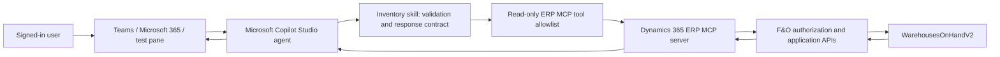

# Inventory Stock Availability Agent

An AI-powered Inventory Stock Availability Agent for Dynamics 365 Finance & Operations, built on Microsoft Copilot Studio.

**The agent runs with the signed-in user's F&O permissions.** Configure the Dynamics 365 ERP MCP connection for end-user authentication: the agent does not grant additional access or elevate permissions.

Ask inventory questions in natural language or submit a JSON array to retrieve current on-hand, reserved, and available quantities by item, warehouse, and legal entity. The agent is **read-only by design**; it does not reserve, transfer, allocate, purchase, or modify inventory.

> **Release status:** No solution ZIP is included in this contribution. The package inspection and installation notes below describe the previously inspected staging export, not an available download. That export is an unmanaged solution with internal version **1.0.0.1**. Archive inspection did not find the inventory skill or ERP MCP tool/connection-reference components, although those are visible in the source agent's Copilot Studio configuration. The archive also contains unrelated Work IQ capability components declaring write access and sets `publishOnImport: true`. Treat that export as a staging release, not a verified production-ready import. Follow the dependency-repair and validation steps below; a successful import alone is not acceptance.

## Table of Contents

- [Use Case](#use-case)
  - [Overview](#overview)
  - [Target Users](#target-users)
  - [Key Scenarios](#key-scenarios)
  - [Problem Statement](#problem-statement)
  - [Current Challenges](#current-challenges)
  - [Solution Capabilities](#solution-capabilities)
  - [Response Handling](#response-handling)
- [Architecture](#architecture)
  - [High-Level Architecture](#high-level-architecture)
  - [Data Flow Diagram](#data-flow-diagram)
- [Extensibility](#extensibility)
- [Pre-Requisites](#pre-requisites)
  - [Licensing](#licensing)
  - [D365 F&O Environment](#d365-fo-environment)
  - [Connectivity & Authentication](#connectivity--authentication)
  - [Administrative Access](#administrative-access)
- [Installation Process](#installation-process)
  - [Phase 1 - Download the Solution Package](#phase-1---download-the-solution-package)
  - [Phase 2 - Import the Solution into Your Environment](#phase-2---import-the-solution-into-your-environment)
  - [Phase 3 - Verify the Imported Solution](#phase-3---verify-the-imported-solution)
  - [Phase 4 - Test the Agent](#phase-4---test-the-agent)
  - [Phase 5 - Production Deployment](#phase-5---production-deployment)
  - [Phase 6 - Publish & Deploy to Channels](#phase-6---publish--deploy-to-channels)
  - [Phase 7 - Configure Security & Access Control](#phase-7---configure-security--access-control)
- [Limitations & Constraints](#limitations--constraints)
- [Microsoft Documentation](#microsoft-documentation)

## Use Case

### Overview

The agent provides a conversational interface to F&O inventory on-hand data. Microsoft Copilot Studio interprets the request, applies the inventory skill, and invokes the Dynamics 365 ERP MCP server to query `WarehousesOnHandV2` in the user's specified legal entity.

Results reflect data returned when the query runs; they are not a reservation or guarantee that stock will remain available.

### Target Users

- Inventory and warehouse teams checking stock availability.
- Sales and customer-service teams answering item availability questions.
- Supply-chain and operations teams comparing warehouse inventory.
- Authorized business users checking whether an available balance meets a requested quantity.

Each user needs the relevant F&O access. Agent access alone does not grant inventory access.

### Key Scenarios

| Scenario | Example request |
|---|---|
| Warehouse availability | "Show availability of ITEM-001 in warehouse WH-01 for COMPANY." |
| Fulfillment check | "Can warehouse WH-01 fulfill 10 units of ITEM-001 in COMPANY?" |
| Warehouse comparison | "Show all warehouse inventory records for ITEM-001 in COMPANY." |
| Multiple items | "Check ITEM-001 and ITEM-002 in warehouse WH-01 for COMPANY." |
| Structured integration | Submit a JSON array with an item, warehouse, and legal entity on each entry. |

`ITEM-001`, `WH-01`, and `COMPANY` are illustrative, not configured defaults. Replace them with authorized values from your environment.

### Problem Statement

Users need a consistent way to find inventory balances without repeatedly navigating F&O pages or manually assembling results for multiple items.

### Current Challenges

- Repeated navigation and manual copying of inventory information.
- Confusion between physical on-hand, reserved, and available quantities.
- Ambiguous item, warehouse, or legal-entity context.
- Time spent checking multiple items or warehouses separately.
- Risk of interpreting missing records as confirmed zero stock.
- Need to preserve each user's existing authorization boundaries.

### Solution Capabilities

- Natural-language requests and structured JSON input.
- Current on-hand, reserved, and available inventory retrieval.
- Explicit legal-entity scoping using `companyId`; no default company.
- Specific-warehouse lookups and explicit all-warehouse natural-language requests.
- Separate lookups for multiple requested items, preserving request order.
- Fulfillment and shortage calculations when one exact warehouse row is returned.
- One bounded schema-discovery fallback, without retrying permission or connectivity errors.
- Read-only operation through the signed-in user's connection and F&O permissions.

### Response Handling

| Condition | Behavior |
|---|---|
| Natural-language success | Direct answer, matching inventory rows, and the AI disclaimer. |
| Missing natural-language context | One clarification question listing missing required values; no tools called. |
| JSON success | One raw JSON object containing `Inventory` and `Disclaimer`; no surrounding prose. |
| Invalid JSON input | A JSON `error` object; validate the entire array before querying. |
| No matching record | Explicit no-record outcome; JSON includes `RecordFound: false` and documented zero placeholders. |
| Multiple dimension rows | Return each row separately; do not infer a combined balance or fulfillment decision. |
| Requested quantity | Calculate fulfillment only for one exact specific-warehouse row; no inventory is reserved. |
| Tool failure | Stop and report the tool error; do not fabricate results or return a partial batch as success. |
| Modification or unrelated request | Return the defined out-of-scope response without calling tools. |

**JSON request example**

Replace the placeholder values before submitting:

```json
[
  {
    "ItemNumber": "<CUSTOMER_ITEM_NUMBER>",
    "Warehouse": "<CUSTOMER_WAREHOUSE>",
    "RequestedQuantity": 10,
    "LegalEntity": "<CUSTOMER_LEGAL_ENTITY>"
  }
]
```

**Illustrative successful JSON response**

The values below are examples, not queried inventory:

```json
{
  "Inventory": [
    {
      "LegalEntity": "COMPANY",
      "ItemNumber": "ITEM-001",
      "ProductName": "Example item",
      "Site": "SITE-01",
      "Warehouse": "WH-01",
      "OnHand": 25,
      "Reserved": 5,
      "Available": 20,
      "RequestedQuantity": 10,
      "CanFulfill": true,
      "Shortage": 0
    }
  ],
  "Disclaimer": "This is an AI-generated output and should be reviewed for accuracy and completeness prior to distribution."
}
```

The corrected release contract adds the top-level `Disclaimer` field so that successful JSON remains valid JSON. Consumers must accept that field. Validation and tool-error objects remain `{"error":"..."}` without a disclaimer.

## Architecture

### High-Level Architecture



The MCP connection must operate on behalf of the chatting user. F&O enforces that user's roles, duties, privileges, and applicable company/data-security policies. Agent sharing, prompt instructions, and an entered company ID do not override those controls.

The MCP query tool uses supported F&O application APIs; this architecture does not require direct SQL database access. The broad ERP MCP server can expose write operations, so its availability alone does not make an agent read-only. Restrict the enabled tools and remove unrelated capabilities.

### Data Flow Diagram

```mermaid
sequenceDiagram
    actor User as Signed-in user
    participant Agent as Copilot Studio
    participant Skill as Inventory skill
    participant MCP as Dynamics 365 ERP MCP
    participant FO as F&O application APIs
    User->>Agent: Natural-language request or JSON array
    Agent->>Skill: Validate complete request and explicit company
    alt Missing or invalid input
        Skill-->>User: Clarification or JSON error; no MCP call
    else Valid input
        loop Each requested item
            Skill->>MCP: data_find_entities_sql(filters, companyId)
            MCP->>FO: Request under signed-in user's permissions
            FO-->>MCP: Authorized rows, no records, or error
            MCP-->>Skill: Query result
            opt Schema error only; one fallback
                Skill->>MCP: Discover WarehousesOnHandV2
                Skill->>MCP: Validate required metadata
                Skill->>MCP: Retry same filtered query if validation succeeds
                MCP-->>Skill: Result or final error
            end
        end
        Skill-->>Agent: Inventory rows or error; permitted derived fields
        Agent-->>User: Natural-language answer or raw JSON
    end
```

Authorization, connectivity, and timeout errors stop processing; they do not trigger schema discovery. Local inventory caching is not part of this design. Copilot Studio conversation records and other platform telemetry remain subject to tenant retention policies.

## Extensibility

### What You Can Extend

- Add authorized read-only inventory entities or approved additional fields.
- Add batch, serial, location, or other dimensions when supported by the selected entity.
- Add validated unit-of-measure handling and clearly defined aggregation rules.
- Add tenant-approved legal-entity restrictions without introducing a default company.
- Add response localization, approved channels, or additional evaluation scenarios.
- Add separate approved read-only skills for related inventory questions.

Because the agent is read-only by design, extensions must preserve the same security posture: **limit them to read operations against entities the connecting account is authorized to view**. In the supported end-user configuration, that account is the signed-in user. Revalidate tool restrictions, company filters, response schemas, and permissions for every extension.

Reservations, stock transfers, allocations, purchasing, and any other writes are outside this release. They require a separate design, authorization review, and explicit approval; do not enable them as incidental extensions.

## Pre-Requisites

### Licensing

- Appropriate Microsoft Copilot Studio authoring/deployment entitlement and runtime capacity or billing for the intended usage.
- Appropriate Dynamics 365 Finance and/or Supply Chain Management licensing and access for each F&O user.
- Teams and Microsoft 365 channel entitlements where those channels are used.
- Any applicable connector, premium capability, model, and tenant licensing requirements.

Licensing varies by tenant, channel, and commercial agreement. Confirm the current requirements with your licensing administrator; this release does not provide licenses or imply that a Microsoft 365 subscription alone covers every deployment.

### D365 F&O Environment

- A supported F&O environment with the **Dynamics 365 ERP Model Context Protocol server** feature enabled.
- Microsoft currently documents base MCP support for 10.0.47, 10.0.46 PQU-2, or 10.0.45 PQU-7 and later supported releases, on Tier 2+ or a Unified Developer Environment, not a Cloud Hosted Environment.
- **This skill additionally requires `data_find_entities_sql`, documented from F&O 10.0.48.** Confirm the tool actually appears in your environment; meeting only the base MCP prerequisite is insufficient. Earlier OData-only tools are not drop-in substitutes for this skill.
- The dynamic ERP MCP server, not the retired static 13-tool implementation.
- `WarehousesOnHandV2` accessible to the intended users with these fields: `ItemNumber`, `ProductName`, `InventorySiteId`, `InventoryWarehouseId`, `OnHandQuantity`, `ReservedOnHandQuantity`, and `AvailableOnHandQuantity`.
- Valid customer items, warehouses, legal entities, and test inventory. No demo company or item is assumed.

See the linked Microsoft prerequisites for changes to supported versions.

### Connectivity & Authentication

- A target Power Platform environment with Dataverse, Copilot Studio availability, and permitted solution imports.
- Network access from the Power Platform connector to the target F&O environment under your tenant policies.
- Microsoft Entra authentication for the agent and end-user/User/invoker authentication for its ERP MCP connection.
- Intended users provisioned in the target F&O environment with the relevant read privileges and company access.
- The Microsoft-managed Copilot Studio client allowed on F&O's **Allowed MCP clients** page. Verify the actual client ID against Microsoft's documentation, not just the row label.
- Power Platform data policies, conditional-access rules, and connector restrictions that permit the integration.

Do not substitute maker-provided credentials to make a connection test pass. Users may need to authorize their own connection on first use.

### Administrative Access

- A maker/deployer account with permission to import solutions, manage the agent, and configure connections in the target environment.
- An F&O administrator authorized to enable MCP, review allowed clients, and assign least-privilege roles.
- A Power Platform administrator for environment, data-policy, and sharing controls.
- Teams/Microsoft 365 administrator approval where organization-wide channel distribution requires it.

Routine agent users do not need administrator roles.

## Installation Process

Use a development or validation environment first. UI labels can differ by Copilot Studio experience; Solutions is also available through [Power Apps](https://make.powerapps.com).

### Phase 1 - Download the Solution Package

1. A solution ZIP is not currently included in this contribution. Obtain a corrected, validated export before proceeding with the installation steps below.
2. Keep the ZIP intact. Do not manually edit its XML or repackage it to repair missing dependencies.
3. Confirm its identity: solution unique name `InventoryStockAvailabilityV1`, version `1.0.0.1`, unmanaged.
4. Verify the staged archive's SHA-256 if checking this exact supplied artifact:

```text
82064D43189633AD405B1082119EDCB26AC01800D183818D4E0AB6349EF64022
```

This checksum identifies the staged file only; it is not a digital signature or a production-readiness certification. A corrected export needs a new published checksum.

#### Solution Package Structure

Published files:

```text
Inventory Stock Availability Agent/
`-- README.md
```

Observed contents of the previously inspected staging ZIP (not included):

```text
solution.xml
customizations.xml
[Content_Types].xml
bots/
  ft_inventorystockavailability_DiZkyr/
    bot.xml
    configuration.json
botcomponents/
  ... Work IQ capability definitions and feedback settings ...
```

The agent instructions and inventory skill are not published as separate files or embedded in this ZIP. Configure them in Copilot Studio as described in this guide. The current archive contains no inventory skill payload or ERP MCP tool/connection-reference components.

### Phase 2 - Import the Solution into Your Environment

#### Step 2.1 - Sign in to Copilot Studio

1. Open [Microsoft Copilot Studio](https://copilotstudio.microsoft.com).
2. Sign in with your authorized maker account.
3. Select the intended non-production environment and verify its name before continuing.

#### Step 2.2 - Navigate to Solutions

1. Open **Solutions** in the maker experience.
2. If not shown, open Power Apps and select the same environment, then **Solutions**.
3. Confirm you have import permission and that the environment permits unmanaged solutions.

#### Step 2.3 - Import the Solution

1. Select **Import solution** and choose the ZIP.
2. Review the displayed name, publisher, version, dependencies, and import messages.
3. Stop for unresolved dependencies or unexpected components; do not bypass the checks.
4. Import only into an isolated validation environment at this stage. The staged bot configuration contains `publishOnImport: true`; do not assume import leaves the agent unpublished.

#### Step 2.4 - Configure the Connection Reference

For a corrected export that includes the ERP MCP connection reference, map it to a connection targeting your F&O instance. Ensure the tool's runtime authentication remains **User/end-user/invoker**, rather than a shared maker identity.

**Current ZIP exception:** this archive has no ERP MCP connection reference. An import wizard that does not request one is therefore not evidence of a working integration. Add or repair the Dynamics 365 ERP MCP connection in Phase 3 and include the required objects in a new export before general distribution.

Never include access tokens, passwords, or other credentials in GitHub assets.

#### Step 2.5 - Complete the Import

1. Complete the wizard and wait for its result.
2. Inspect the import log and resolve errors before opening the agent for validation.
3. Confirm the imported solution appears with the expected internal version.
4. Keep the agent unshared with production users until all acceptance checks pass.

### Phase 3 - Verify the Imported Solution

#### Step 3.1 - Open the Solution

1. Open the imported solution and its **Inventory Stock Availability** agent.
2. Configure the agent instructions and add the inventory skill in Copilot Studio. The published files do not include separate instruction or skill files, and importing the ZIP does not configure them.
3. Use the behavior and safety requirements in this guide, including explicit legal-entity scoping, read-only inventory lookups, and clear handling of errors and unavailable data.
4. Remove the unrelated Work IQ Teams, files, mail, calendar, people, and sites capabilities from the authoring configuration. These are not required for inventory queries. Do not confuse these capabilities with the Teams + Microsoft 365 publishing channel.
5. If any unwanted capability cannot be removed or verified in the UI, stop distribution and resolve it through supported authoring/export tooling; do not edit the ZIP by hand.
6. Keep web search and cross-session memory disabled for this inventory-only release.
7. Review the selected model. The supplied configuration uses GPT 5.5 Chat, and the source screenshot displays a retirement warning. Select a currently supported, tenant-approved model and rerun the tests rather than relying on automatic migration.

#### Step 3.2 - Update the F&O Instance URL in Tools

1. Open **Tools** and the **Dynamics 365 ERP MCP** connection. If missing, use **Add a tool**, select the MCP category, and add the dynamic ERP MCP server.
2. Set the F&O instance/environment URL in the connection or tool configuration exposed by your connector experience. Replace any source-environment URL.
3. If an existing connection cannot change its instance, create a connection for the correct instance and rebind the tool.
4. Select **User/end-user/invoker** authentication. Confirm the deployed channel executes with each chatting user's own F&O identity.
5. Enable only:
   - `data_find_entities_sql`
   - `data_find_entity_type`
   - `data_get_entity_metadata`
6. Disable data-write, form-action, business-action, and unrelated MCP tools. If your experience cannot restrict the exposed tools, stop production deployment until an enforceable approved restriction is in place. Prompt instructions alone are not sufficient.

Do not replace the required SQL tool with a similarly named tool without revising and testing the skill.

#### Step 3.3 - Verify Connection Is Working

1. Authenticate as an intended test user with F&O inventory read access.
2. Confirm all three required tools are available.
3. Query a known customer item, warehouse, and legal entity.
4. Compare returned values with F&O for the same dimensions and time.
5. Test another user with narrower permissions; confirm there is no shared-maker access or company-access bypass.

| Symptom | Checks |
|---|---|
| No tools found | MCP feature, supported F&O version, allowed Copilot Studio client, target URL, and connection authentication. |
| SQL tool missing | SQL-tool version support and dynamic versus retired static MCP server. |
| HTTP 401/403 | User provisioning, authentication, company access, F&O privileges, allowed client, and conditional access. Do not solve this by widening permissions unnecessarily. |
| Unknown entity or field | Verify the entity contract; allow only the skill's bounded schema fallback. |
| No inventory row | Verify exact customer identifiers; do not substitute another company or warehouse. |

### Phase 4 - Test the Agent

Replace all example identifiers with customer test data. Use the same dimensions when comparing with F&O.

| Test | Acceptance criterion |
|---|---|
| Known item and warehouse | Values match the authorized F&O result; one SQL call on the fast path. |
| Missing natural-language company | One clarification question; no MCP call and no default company. |
| Missing natural-language warehouse | Clarification unless an all-warehouse request was explicit. |
| Valid JSON request | Parses as one object with `Inventory` and `Disclaimer`; no prose or fences. |
| Invalid JSON, empty array, invalid quantity | Exact invalid-input error; no MCP calls. |
| Multiple JSON items | One fast-path query per item with its own `companyId`; request order preserved. |
| Fulfillment on one exact row | `CanFulfill = Available >= RequestedQuantity`; `Shortage = max(RequestedQuantity - Available, 0)`. |
| Multiple dimension rows | Separate rows; no automatic aggregation or fulfillment result. |
| All-warehouse natural-language request | Only the warehouse predicate omitted; item and company remain scoped. |
| Unknown item or warehouse | Explicit no-record result; JSON uses `RecordFound: false`, not claimed zero balances. |
| Identifier containing a single quote | Quote escaped as SQL literal data; no broadened query. |
| Controlled schema failure | At most one discovery call, one metadata call, and one final query for the failed lookup. |
| Authorization/connectivity failure | Error returned without schema fallback, fabricated balances, or partial-success batch. |
| Unauthorized user/company | No unauthorized inventory returned; no use of maker credentials. |
| Reserve, transfer, or unrelated request | Exact out-of-scope response; no tool invocation. |
| Repeated request after source data changes | Fresh query, not cached inventory. |

Run these checks in both the authoring test pane and the intended published channel. A screenshot or a successful maker test is not a substitute for end-user authentication testing.

### Phase 5 - Production Deployment

1. Repair and test the source authoring solution, including the corrected skill, instructions, MCP connection reference, and required components.
2. Remove unrelated capabilities through supported tooling, add required objects/dependencies, and export a fresh solution. Do not merely rename the staged ZIP.
3. Verify the new export includes or correctly resolves the inventory skill and ERP MCP integration. Update the filename, internal version, README metadata, and checksum together.
4. Prove import into a clean validation environment, including authentication and the complete Phase 4 test matrix.
5. Choose the organization's approved ALM approach. The supplied package is unmanaged; if production policy requires managed solutions, export a managed artifact from the source solution and test that artifact separately.
6. Obtain business, platform, security, and licensing approval. Record the approved model, entity contract, target environment, and rollback approach.
7. Apply the Phase 7 security controls **before** importing or exposing the production agent. Phase numbering does not defer security configuration.
8. Deploy the validated artifact, bind target-environment connections, verify effective identity, and smoke-test before sharing.

Keep a known-good prior artifact and configuration. Rollback must follow your solution-management policy; importing an older unmanaged ZIP is not a guaranteed rollback.

### Phase 6 - Publish & Deploy to Channels

1. Confirm production acceptance and Phase 7 controls are complete.
2. Save the agent and publish the reviewed configuration. Authentication changes require republishing.
3. Configure the **Teams + Microsoft 365** channel where available and approved for your tenant.
4. Use **Authenticate with Microsoft** for the built-in Teams + Microsoft 365 experience, while separately preserving end-user authentication on the MCP connection.
5. Follow the channel's availability/sharing settings and tenant app approval process. Do not assume imported channel metadata creates a usable channel.
6. Start with a restricted pilot group, verify first-use sign-in and F&O identity, then expand only after approval.
7. Retest inventory access and denial scenarios from the actual published channel.

Publishing, channel distribution, agent sharing, and F&O authorization are separate steps. Do not enable anonymous access for this solution.

### Phase 7 - Configure Security & Access Control

Complete these controls before production exposure and maintain them after deployment:

- Require authenticated users and restrict agent/channel availability to approved users or groups.
- Keep runtime MCP authentication delegated to the signed-in user, never a shared privileged maker account.
- Apply least-privilege F&O roles, duties, privileges, and applicable legal-entity/data restrictions.
- Allow the correct Copilot Studio application on **Allowed MCP clients**; do not authorize unknown clients by display name alone.
- Enforce the three-tool read-only allowlist and remove unrelated Work IQ/write capabilities.
- Keep the required user-supplied `companyId` filter on every lookup. Treat this as request scoping, not a substitute for F&O authorization.
- Apply Power Platform data policies, conditional access, environment controls, and tenant-approved model settings.
- Review conversation transcripts, diagnostics, and retention policies; inventory results can contain business-sensitive information.
- Restrict maker/coauthor and solution-import permissions separately from agent-user access.
- Retest permissions, tools, channels, and response schemas after model, solution, connector, or platform updates.

The read-only posture depends on configured capabilities and platform authorization, not solely on natural-language instructions.

## Limitations & Constraints

- The supplied staging ZIP has unresolved packaging discrepancies; it does not include separate agent-instructions or skill files.
- F&O and Copilot Studio version, feature, region, licensing, model, connector, and tenant-policy availability can affect deployment.
- The skill requires the dynamic ERP MCP SQL query tool and the specified `WarehousesOnHandV2` fields.
- Every lookup requires an explicit legal entity. JSON also requires a warehouse per item.
- Requested quantity is optional and must be positive. It supports a calculation, not a reservation or promise of delivery.
- Multiple inventory dimension rows are not automatically aggregated. Unit conversion and cross-warehouse allocation are not implemented.
- No matching record is distinct from a confirmed zero inventory balance.
- Inventory can change immediately after the query. A multi-item request is not an atomic inventory snapshot.
- One fast-path call is made per item, with up to three additional calls for an eligible failed lookup's schema fallback. Large requests are subject to platform timeouts, limits, and cost.
- Pagination/completeness for very large all-warehouse result sets must be validated in the target environment; do not claim a complete total from truncated results.
- Tool errors stop a batch; this contract does not return partial successes.
- There are no inventory writes, product recommendations, pricing, purchasing, stock reservations, transfers, or allocations.
- Prompt-driven output still requires testing and review; strict machine consumers should validate the JSON schema.
- The added JSON `Disclaimer` field is an intentional response-contract change from the original skill.
- No execution of live F&O queries, clean-environment import, channel deployment, or production acceptance is established by this README.

## Microsoft Documentation

- [Export and import agents using solutions](https://learn.microsoft.com/en-us/microsoft-copilot-studio/authoring-solutions-import-export)
- [Use Model Context Protocol for finance and operations apps](https://learn.microsoft.com/en-us/dynamics365/fin-ops-core/dev-itpro/copilot/copilot-mcp)
- [Build an agent with Dynamics 365 ERP MCP](https://learn.microsoft.com/en-us/dynamics365/fin-ops-core/dev-itpro/copilot/build-agent-mcp)
- [Dynamics 365 ERP MCP security](https://learn.microsoft.com/en-us/dynamics365/fin-ops-core/dev-itpro/copilot/mcp/mcp-security)
- [Configure user authentication](https://learn.microsoft.com/en-us/microsoft-copilot-studio/configuration-end-user-authentication)

Always use current Microsoft guidance for licensing, supported versions, authentication, and channel prerequisites.
