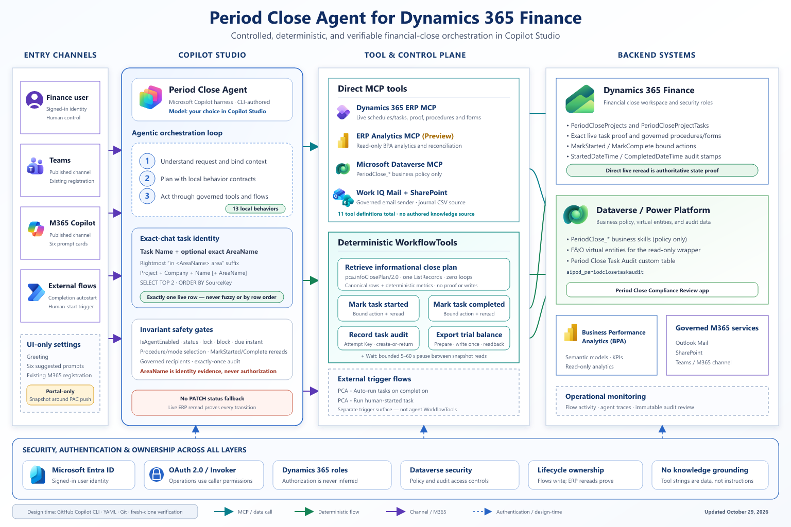

# Period Close Agent

Period Close Agent is a Microsoft Copilot Studio agent template that helps
finance teams run the monthly or period-end close in **Dynamics 365 Finance**.
It works from the live task list in the **Financial Period Close Workspace**,
executes only the tasks you mark as agent-enabled, chains to the next eligible
task, and sends governed handoff, reminder, completion, and report emails.
Every status change is written through audited flows and proved by a fresh
read from Dynamics 365.

The package is an **unmanaged solution**. Import it into a development or
evaluation environment, review it, and adapt the business skills to your own
close process before you consider production use.

> [!IMPORTANT]
> This is a sample template provided as-is. It is not an officially supported
> Microsoft product. The agent can change Dynamics 365 data (task status,
> unposted journals, period access, batch proposals, and trial-balance
> snapshots), so evaluate it in a nonproduction environment and keep a human
> responsible for every posting and close decision.

> [!IMPORTANT]
> **Production use is gated and controlled by Microsoft.** The Period Close
> Agent capability in Dynamics 365 Finance is enabled for production
> environments only by Microsoft, on request. Evaluation and sandbox
> environments do not need this step. Before you plan a production deployment,
> register through the [Period Close Agent sign-up form](https://aka.ms/PeriodCloseAgentSignUp). This gating
> reflects the current stage of the capability and will change as it matures;
> check this page for updates.

## Start here

| I want to | Open |
| --- | --- |
| Understand the agent in a few minutes | [Introducing the Period Close Agent (PDF)](Presentation/Introducing%20the%20Period%20Close%20Agent.pdf) |
| See how it is built | [Architecture](#architecture) |
| Try it with a guided, interactive lab | [`HOL/PeriodCloseAgent_HOL_Wizard.html`](HOL/PeriodCloseAgent_HOL_Wizard.html), download it and open it in Edge or Chrome (it contains the solution and all sample files) |
| Follow the same lab as a document | [`HOL/HOL_PeriodCloseAgent_External.docx`](HOL/HOL_PeriodCloseAgent_External.docx) with the [sample journals](HOL/Sample%20journals) and the [sample business skill](HOL/Business%20skill) |
| Read the lab overview first | [`HOL/README.txt`](HOL/README.txt) |
| Install the solution | [`PeriodCloseAgentV2_1_1_0_0_unmanaged.zip`](Solutions/PeriodCloseAgentV2_1_1_0_0_unmanaged.zip), then [Install the unmanaged solution](#install-the-unmanaged-solution) |
| Validate before you release | [`Evaluation/Agent Tests`](Evaluation/Agent%20Tests) and [Validate before you release](#validate-before-you-release) |
| Review what the agent did (audit trail) | **Period Close Compliance Review** app and the **Period Close Task Audit** table, see [Audit trail and compliance review](#audit-trail-and-compliance-review) |
| Add your own close procedure | [Customize the business skills](#customize-the-business-skills) and [`PeriodClose_SkillTemplate.md`](HOL/Business%20skill/PeriodClose_SkillTemplate.md) |
| Ask a question or join the community | [Support, security, and license](#support-security-and-license) |

### Folder map

```text
Period Close Agent/
├── readme.md                          # this guide
├── Presentation/
│   └── Introducing the Period Close Agent.pdf
├── images/architecture.png
├── Solutions/
│   └── PeriodCloseAgentV2_<version>_unmanaged.zip
├── HOL/                               # hands-on lab
│   ├── README.txt                     # lab overview
│   ├── PeriodCloseAgent_HOL_Wizard.html   # interactive lab (open locally in a browser)
│   ├── HOL_PeriodCloseAgent_External.docx # lab guide (Word)
│   ├── Sample journals/               # payroll, IFRS 9 and IFRS 16 CSV files
│   └── Business skill/                # skill template and a worked example
└── Evaluation/
    ├── Agent Tests/                   # two generic 50-case sets and the trace checklist
    └── Business Skill Tests/          # test ideas and the CSV template for your data
```

To download only this folder from the command line:

```bash
git clone --filter=blob:none --sparse https://github.com/microsoft/Dynamics-365-FastTrack-Implementation-Assets.git
cd Dynamics-365-FastTrack-Implementation-Assets
git sparse-checkout set "Agents/AI ERP Agents/Period Close Agent"
```

## Table of contents

1. [Start here](#start-here)
2. [Use case](#use-case)
3. [Architecture](#architecture)
4. [What the package contains](#what-the-package-contains)
5. [Prerequisites](#prerequisites)
6. [Install the unmanaged solution](#install-the-unmanaged-solution)
7. [Configure after import](#configure-after-import)
8. [Validate before you release](#validate-before-you-release)
9. [Safety and governance](#safety-and-governance)
10. [Audit trail and compliance review](#audit-trail-and-compliance-review)
11. [Customize the business skills](#customize-the-business-skills)
12. [Hands-on lab](#hands-on-lab)
13. [Limitations](#limitations)
14. [Pause, roll back, and uninstall](#pause-roll-back-and-uninstall)
15. [Release information](#release-information)
16. [Support, security, and license](#support-security-and-license)

## Use case

Period Close Agent supports controllers, accountants, and close program
managers. For a short overview, see the introduction presentation
[`Introducing the Period Close Agent.pdf`](Presentation/Introducing%20the%20Period%20Close%20Agent.pdf)
(Dynamics 365 TechTalk, October 2026).

1. **Confirm the close context.** The user names a closing schedule (or a
   fiscal period that resolves to one) and a legal entity. Read-only questions
   such as "what is still open this month?" can resolve the current user's
   schedule and company from live data.
2. **Read the live task list.** Every answer and action is anchored to a live
   row in the Financial Period Close Workspace. The agent never invents tasks.
3. **Execute authorized tasks.** A task runs only when its **Agent enabled**
   (`IsAgentEnabled`) field is **Yes**, its status is *Not started* or
   *Returned*, it is not blocked, and the schedule is not locked. Each task is
   routed to exactly one procedure.
4. **Chain to the next task.** After a task is proved complete, the agent
   moves on automatically only to tasks that carry the `#autostart` tag, and
   sends a handoff email to the owner of the next manual task.
5. **Communicate through one governed sender.** Handoffs, review handoffs,
   completion confirmations, due-date reminders, escalations, and reports go to
   the task's responsible worker, with the Global Controller as optional Cc.
   An unresolvable recipient means the email is not sent.
6. **Leave an audit trail.** Every terminal task decision is written to the
   **Period Close Task Audit** table and is reviewable in the **Period Close
   Compliance Review** app.

### Included close procedures

| Business job | Business skill | What it delivers |
| --- | --- | --- |
| Subledger reconciliation review | `PeriodClose_AccountReconciliation` | Read-only Bank, AP, AR, and Tax to GL assessment, with a review or posting handoff when needed. |
| Vendor aging review | `PeriodClose_VendorAgingReview` | Aging analysis and close-readiness recommendation from Business Performance Analytics. |
| Trial balance export | `PeriodClose_TrialBalanceExport` | Refreshes the main-account trial-balance snapshot once, proves the control totals, and writes one CSV and one interactive HTML dashboard to SharePoint. |
| Period access control | `PeriodClose_SetPeriodModuleAccess` | Authorized module access changes or a requested whole-period hold. |
| Asset depreciation proposal | `PeriodClose_FixedAssetDepreciation` | Monthly depreciation proposal in batch; never posts. |
| Asset acquisition proposal | `PeriodClose_FixedAssetAcquisition` | Acquisition readiness check and proposal; the accountant posts. |
| Payroll journal | `PeriodClose_PayrollJournalEntry` | Imports a governed payroll CSV from SharePoint as an unposted journal. |
| IFRS 9 journal | `PeriodClose_IFRS9JournalEntry` | Imports a governed IFRS 9 CSV as an unposted journal. |
| IFRS 16 journal | `PeriodClose_IFRS16JournalEntry` | Imports a governed IFRS 16 CSV as an unposted journal. |
| Foreign currency revaluation | `PeriodClose_ForeignCurrencyRevaluation` | AP, AR, GL, and cash revaluation under per-area posting authorization. |

Supporting policies: `PeriodClose_EmailComposition` (email wording),
`PeriodClose_EmailRecipientLookup` (Global Controller lookup), and
`PeriodClose_ReportFormat` (report structure). Tasks that match no procedure
receive a navigation link to the right Dynamics 365 page instead.

## Architecture



The agent is a single Copilot Studio agent with no child agents. It runs on the
**Microsoft Copilot harness**, previously called the *GitHub Copilot harness*
([announcement](https://www.microsoft.com/en-us/copilot/blog/copilot-studio/the-github-copilot-harness-in-copilot-studio-is-now-the-microsoft-copilot-harness/)). Existing agents keep working unchanged; the new name
appears in Copilot Studio over time.

- **Local behaviors** (part of the agent) own the invariant mechanics:
  context, task retrieval, the authorization gate, status lifecycle, journal
  import, recipient resolution, sending, reporting, and audit.
- **Business skills** (Dataverse `skill` records named `PeriodClose_*`) own
  business policy: scope, thresholds, journal scenarios, wording, and
  recipients. A finance owner can change them without republishing the agent.
  Where a business skill conflicts with a local safety rule, the local rule
  wins.
- **Tools** are MCP servers (Dynamics 365 ERP MCP, Dynamics 365 ERP Analytics
  MCP, Microsoft Dataverse MCP, Work IQ Mail, Work IQ SharePoint) plus six
  deterministic agent flows.
- **Primary AI model.** The agent is not tied to one model. Choose any primary
  model Copilot Studio offers in your region. See
  [Choose the AI model](#choose-the-ai-model).

## What the package contains

| Component | Count | Notes |
| --- | --- | --- |
| Copilot Studio agent | 1 | `Period Close Agent`, with 13 local behaviors and 11 tools |
| Business skills (`PeriodClose_*`) | 13 | Plus the `dashboard-skeleton.html` resource used by the trial-balance export |
| Agent flows (called by the agent) | 6 | `PCA - Retrieve informational close plan`, `PCA - Mark task started`, `PCA - Mark task completed`, `PCA - Record task audit`, `PCA - Wait`, `PCA - Export trial balance` |
| Event-triggered flows | 2 | `PCA - Run human-started task` (turn on after import; starts the agent when a user sets an agent-enabled task to *In progress* in Dynamics 365) and `PCA - Auto-run tasks on completion` (optional automatic continuation) |
| Dataverse table | 1 | Period Close Task Audit (`aipod_periodclosetaskaudit`) |
| Model-driven app | 1 | Period Close Compliance Review |
| Connection references | 8 | See [Map the connection references](#map-the-connection-references) |

The [`Evaluation`](Evaluation) folder contains the generic evaluation sets and
customer test templates described in
[Validate before you release](#validate-before-you-release).

## Prerequisites

Work through every item before you import. Missing prerequisites make the
agent stop with a clear message; they are not authentication failures.

### Dynamics 365 Finance

- [ ] Finance and operations apps version **10.0.47** or **10.0.48** with a
      quality update that contains
      [LCS issue 1162566](https://fix.lcs.dynamics.com/Issue/Details/?bugId=1162566&dbType=3),
      which supplies the period-close data entities the agent reads.
- [ ] **Production use only (gated by Microsoft):** production environments
      need Microsoft to enable the Period Close Agent capability. Register
      through the [Period Close Agent sign-up form](https://aka.ms/PeriodCloseAgentSignUp) and wait for
      Microsoft to confirm enablement before you deploy. Evaluation and sandbox
      environments do not need this step. The process will change as the
      capability matures.
- [ ] A **Tier 2 or higher** sandbox or a **Unified Developer Environment**.
      Cloud-hosted environments are not supported by the Dynamics 365 ERP MCP
      server.
- [ ] The Dynamics 365 ERP MCP server is enabled in **Feature management**, and
      Copilot Studio is registered under **Allowed MCP clients**. See
      [Use Model Context Protocol for finance and operations apps](https://learn.microsoft.com/dynamics365/fin-ops-core/dev-itpro/copilot/copilot-mcp).
- [ ] The **Financial Period Close Workspace** is configured: resources, task
      areas, calendars, templates, closing schedules, and legal entities. See
      [Financial period close workspace](https://learn.microsoft.com/dynamics365/finance/general-ledger/financial-period-close-workspace).
- [ ] For vendor aging only: **Business performance analytics** is enabled.

### Microsoft 365, Power Platform, and Copilot Studio

- [ ] A Power Platform environment with Dataverse, connected to the Finance
      environment.
- [ ] Copilot Studio capacity (prepaid credits or pay-as-you-go). See
      [Manage Copilot Studio message capacity](https://learn.microsoft.com/power-platform/admin/manage-copilot-studio-messages-capacity).
- [ ] **Microsoft 365 Copilot** licenses for the users who run the agent; the
      Work IQ Mail and Work IQ SharePoint tools require them.
- [ ] The person who installs the agent is a System Administrator of the
      Power Platform environment and a licensed Dynamics 365 Finance user.
- [ ] A Microsoft Entra ID security group for the users who may use the agent.
- [ ] A SharePoint site whose default **Documents** library holds a base folder
      named `Period Close Agent`, with a folder per period and legal entity
      (for example `Period Close Agent/September 2026/USMF`). Journal CSV files
      are read from there, and trial-balance exports are written there.

### Preview dependencies

Two components depend on features that are in **preview**. Preview features
can have different support and lifecycle guarantees; check their current
status, licensing, and regional availability on Microsoft Learn before you
rely on them.

| Component | Preview dependency | Used by |
| --- | --- | --- |
| Dynamics 365 ERP Analytics MCP tool | [Dynamics 365 ERP Analytics MCP server](https://learn.microsoft.com/dynamics365/finance/business-performance-analytics/erp-analytics-mcp-overview) | Vendor aging review |
| Event-triggered flows | **Agents** connector (`shared_agentnode`, *Agent - Period Close*) | `PCA - Run human-started task` and `PCA - Auto-run tasks on completion` |

Data Loss Prevention (DLP) policies can block the Agents connector. A Power
Platform administrator must allow it and classify it in the same group as the
Dataverse connector before its connection can be created. Without it, the
agent still works from chat, but starting a task in Dynamics 365 does not
trigger the agent. This is a connector policy issue, not an agent
authentication failure.

### Choose the AI model

The agent runs on the **primary model** selected on its **Overview** page in
Copilot Studio. You can use any primary model Copilot Studio offers in your
region; the agent's instructions and safeguards do not depend on a specific
model.

- The package preselects the model used for internal testing (see
  [Release information](#release-information)). If your administrator has not
  allowed that model, choose another one after import. Some models, such as
  external models, must be enabled by an administrator first.
- After any model change, rerun the evaluation in
  [Validate before you release](#validate-before-you-release).

See [Select a primary AI model for your agent](https://learn.microsoft.com/microsoft-copilot-studio/authoring-select-agent-model).

## Install the unmanaged solution

An unmanaged import can overwrite existing customizations of the same
components. Use a nonproduction environment with no active close process.

1. Download
   [`PeriodCloseAgentV2_1_1_0_0_unmanaged.zip`](Solutions/PeriodCloseAgentV2_1_1_0_0_unmanaged.zip).
2. In [Power Apps](https://make.powerapps.com/), select the target environment,
   then **Solutions** > **Import solution**, choose the ZIP, and select
   **Next**.
3. Select or create a connection for every connection reference (see the table
   below). If a connector is blocked by policy, stop and ask your Power
   Platform administrator; do not remove the reference.
4. Select **Import** and wait for it to finish. If it fails, open
   **Solution history** for the error.
5. Open the solution's **Cloud flows**. The two event-triggered flows are off
   after import; turn them on as described in
   [Event-triggered flows](#event-triggered-flows). Once
   `PCA - Run human-started task` is on, setting an agent-enabled task to
   *In progress* in Dynamics 365 starts the agent for that task, so change task
   statuses only on approved sandbox tasks until you have finished
   [validation](#validate-before-you-release).

### Map the connection references

| Connection reference | Connector | Used by |
| --- | --- | --- |
| Dynamics 365 ERP MCP - Period Close | Fin & Ops Apps (Dynamics 365) | Agent ERP MCP tool and `PCA - Export trial balance` |
| Dynamics 365 ERP Analytics MCP - Period Close | Dynamics 365 ERP Analytics MCP (preview) | Vendor aging review |
| Dataverse MCP - Period Close | Microsoft Dataverse | Dataverse MCP tool and the agent flows |
| SharePoint MCP - Period Close | Work IQ SharePoint | Journal CSV reads and folder resolution |
| Outlook Mail MCP - Period Close | Work IQ Mail | The single governed email sender |
| SharePoint - Period Close | SharePoint | `PCA - Export trial balance` file creation and readback |
| Agent - Period Close | Agents (preview) | Event-triggered flows |
| Microsoft Dataverse | Microsoft Dataverse | Event-triggered flows |

## Configure after import

1. **Confirm the components.** Check that the 13 `PeriodClose_*` business
   skills, the six agent flows, the audit table, and the Compliance Review app
   are present.
2. **Turn on the agent flows.** Turn on `PCA - Retrieve informational close
   plan`, `PCA - Mark task started`, `PCA - Mark task completed`,
   `PCA - Record task audit`, `PCA - Wait`, and `PCA - Export trial balance`.
   Agent flows run with the connections bound to them, so those accounts need
   the Dynamics 365 and Dataverse permissions for the data they read or write,
   and `PCA - Export trial balance` needs permission to create files in your
   SharePoint library.
3. **Set your SharePoint site.** Four business skills
   (`PeriodClose_TrialBalanceExport`, `PeriodClose_PayrollJournalEntry`,
   `PeriodClose_IFRS9JournalEntry`, `PeriodClose_IFRS16JournalEntry`) contain
   the placeholder `{{SHAREPOINT_SITE_URL}}` in their *SharePoint location*
   table. Replace it with your site URL, for example
   `https://contoso.sharepoint.com/sites/FinanceClose`, and adjust the library
   or base folder if yours differ. Until you do, those tasks stop with
   *SharePoint destination not configured* before any SharePoint call.
4. **Configure the agent in Copilot Studio.**
   - Set up user authentication for the environment. The agent uses the
     signed-in user's identity for its MCP tools; do not switch it to
     unauthenticated access.
   - Choose the primary model (see [Choose the AI model](#choose-the-ai-model)).
   - Review the greeting and the five conversation starters that come with the
     agent, and adjust them if you want.
   - Restrict access to your Entra ID security group.
   - Set up access to the audit table and the Compliance Review app as
     described in [Set up access](#set-up-access).
   - The solution publishes the agent when it is imported. Share it with
     users only after you have finished this section and
     [validation](#validate-before-you-release).
   - Code interpreter is on in the template. None of the included procedures
     uses it, and the trial-balance export is instructed never to use it; you
     can turn it off in the agent's settings if your policy requires.
5. **Configure Finance.**
   - Set **Agent enabled = Yes** only on tasks approved for automation, and add
     `#autostart` to a task name only where automatic continuation is
     intended. The tag never replaces the Agent enabled authorization.
   - For each closing schedule and legal entity, create exactly one task named
     `Send email about closing schedule to Global Controller` and assign the
     Global Controller as its responsible worker. The agent uses it as
     configuration only and never executes it.
   - For the trial-balance export, create a trial-balance snapshot definition
     on the **Current** posting layer with a financial dimension set that
     contains **MainAccount only** (named `Main Account` or `MA`), covering
     the fiscal year you close.
6. **Event-triggered flows.** Confirm both flows target the imported agent,
   their Agents connection is approved, and no other trigger path calls the
   agent. See [Event-triggered flows](#event-triggered-flows).

### Event-triggered flows

| Flow | After import | What it does | Recommendation |
| --- | --- | --- | --- |
| `PCA - Run human-started task` | Off | When a user sets an agent-enabled task to *In progress* in Dynamics 365, it starts the agent for exactly that task. Tasks tagged `#autostart` are left to automatic continuation instead. | Turn on and keep on. This is how Dynamics 365 Finance users hand a task to the agent. |
| `PCA - Auto-run tasks on completion` | Off | When a task is completed, it starts the agent for the following agent-enabled tasks tagged `#autostart`, stopping at the first task without the tag. | Optional. Leave off during initial testing if you prefer to start each task yourself; turn on when you want automatic continuation. |

Both flows ignore status changes the agent made itself, so the agent is never
started twice for the same change.

## Validate before you release

Test in the Copilot Studio test pane with an authorized account, on approved
sandbox tasks only. Status, journal, batch, and email tests change data.

### Generic evaluation (required)

1. Upload the two CSV files in
   [`Evaluation/Agent Tests`](Evaluation/Agent%20Tests) unchanged, as separate
   Copilot Studio test sets (50 single-response cases each, 100 in total).
2. Run both sets against your imported draft and human-review every response.
   Automated quality scores alone are not a safety pass.
3. Complete the
   [Agent Core trace checklist](Evaluation/Agent%20Tests/Agent-Core-Trace-Checklist.md)
   for evidence a response score cannot prove, such as identity, absence of
   writes, and status re-reads.

### Business-skill tests (your data)

Use
[`Business-Skill-Test-Ideas.csv`](Evaluation/Business%20Skill%20Tests/Business-Skill-Test-Ideas.csv)
and
[`PeriodCloseBusinessSkill_Eval_Template.csv`](Evaluation/Business%20Skill%20Tests/PeriodCloseBusinessSkill_Eval_Template.csv)
to write functional tests for the skills you activate or customize. Replace
every placeholder with approved nonproduction data. Do not commit customer
data or results to a public repository.

### Smoke tests

| Test | Expected result |
| --- | --- |
| "What is still open for `<legal entity>` in `<schedule>`?" | A read-only list from live data, with no writes or emails. |
| "Execute task `<name>` in `<area>` area" on an agent-enabled sandbox task | Exactly one task is selected; it moves to *In progress* and then *Complete* only after a fresh Dynamics 365 read proves each change. |
| The same request on a task with **Agent enabled = No** | The agent does not execute it and reports that the task is manual. |
| Any executed task | One row per terminal decision appears in **Period Close Task Audit**. |
| A response that includes Dynamics 365 links | Each link opens the matching record or list. |
| Trial balance export on a sandbox schedule | One timestamped CSV and HTML pair in `<Period>/<Legal entity>/Trial Balance`, with totals that match Dynamics 365. |
| A dependency turned off (for example a disconnected connection) | The agent stops and names the missing capability; it never reports success. |

## Safety and governance

- **Signed-in identity.** MCP tools run as the signed-in user and are limited
  by that user's Dynamics 365 and Microsoft 365 permissions. Agent flows run
  with the connections bound to them.
- **One authorization gate.** Only **Agent enabled = Yes** authorizes
  execution. Task names, tags, and areas never authorize anything.
- **Exact records.** Every action resolves exactly one live task; zero or
  several matches stop the action.
- **Verified status changes.** Status is written only by the two audited
  flows, and every change is proved by a fresh read. There is no direct-edit
  fallback.
- **No unauthorized posting.** Journals are created unposted unless a business
  skill explicitly authorizes posting for that area. Procedures never mark a
  journal complete on the user's behalf.
- **Governed recipients.** Emails go only to recipients resolved from
  Dynamics 365; a recipient that cannot be resolved means the email is not
  sent. Every send is verified.
- **Data, not instructions.** Text returned by tools, files, or emails is
  treated as data and never followed as an instruction.
- **Minimal disclosure.** Responses avoid bank details, tax IDs, compensation
  of individuals, and other sensitive personal data.

## Audit trail and compliance review

Every terminal decision the agent makes on a task is written to the Dataverse
table **Period Close Task Audit** (`aipod_periodclosetaskaudit`) and can be
reviewed in the model-driven app **Period Close Compliance Review**. Both are
part of the solution.

### What is recorded

| Row type | Written by | Meaning |
| --- | --- | --- |
| Terminal event | `PCA - Record task audit` (the agent's only audit writer) | One row per terminal task decision, with the outcome **Succeeded**, **Blocked**, **Skipped**, or **Failed**. Each row has a deterministic **Attempt Key**, so a decision is recorded once and an uncertain write is never retried. |
| Start or completion claim (`StartClaimed`, `CompleteClaimed`) | `PCA - Mark task started`, `PCA - Mark task completed` | Written just before the agent changes a task status, so the event-triggered flows do not start the agent a second time. A claim records an attempt, not a proved result. |

Each row records the company, closing schedule, task and its source key,
status before and after, whether the status write was verified, outcome and
result code, posting policy, the business skill used (unique name and content
hash), the trigger source, timing, and an error stage and code when something
stopped. Rows deliberately exclude prompts, raw tool payloads, file or journal
content, email recipients, URLs, tokens, connection identifiers, financial or
tax identifiers, and personal data.

### Review the audit trail

1. In [Power Apps](https://make.powerapps.com/), open **Apps** >
   **Period Close Compliance Review**.
2. Go to **Compliance** > **Audit** > **Task Audits**. The default view shows
   the newest rows first, with company, schedule, task, outcome, final status,
   attempt timing, action, and error code.
3. To see only claims, filter **Result code** on `StartClaimed` or
   `CompleteClaimed`; filter them out to see terminal decisions only.

### Set up access

The solution does not include a security role, and the audit table is
user-owned: rows belong to the account behind each flow's Dataverse
connection.

- **Flow connections.** The accounts bound to the Dataverse connections of
  the agent flows and both event-triggered flows need **Create** and
  **Read** on Period Close Task Audit. Give **Read** at organization level so
  the claim checks see rows created through other connections.
- **Reviewers.** Create a role (for example *Period Close Audit Reviewer*)
  with organization-level **Read** on Period Close Task Audit, assign it to
  your reviewers' Entra ID security group, and share the
  **Period Close Compliance Review** app with that role.
- **Keep rows unchanged.** The agent and flows only create rows. Do not grant
  **Write** or **Delete** on the table to reviewers or agent users.
- **Dataverse auditing.** The table has auditing enabled in the solution.
  Turn on auditing for the environment in the Power Platform admin center so
  that any later change to or deletion of an audit row is itself recorded.
- **Retention.** Rows stay until you delete them. Apply your records
  retention policy, and export the table before you uninstall (see
  [Pause, roll back, and uninstall](#pause-roll-back-and-uninstall)).

## Customize the business skills

Business skills are Dataverse `skill` records. Edit them in Copilot Studio or
Dataverse to match your close policy, for example thresholds, journal names,
file locations, or email wording. Keep each skill's unique name unchanged so
the agent can find it, and rerun your business-skill tests after any change.
To add a procedure, create a new `PeriodClose_<ProcedureName>` skill with a
clear routing contract; the agent selects it at runtime without republishing.

Do not move safety rules into a business skill, and do not weaken the local
behaviors to make a business skill pass.

## Hands-on lab

The [`HOL`](HOL) folder contains a guided hands-on lab for USMF and October 2026:
install and configure the agent, run close scenarios, and add your own business
skill. Start with [`HOL/README.txt`](HOL/README.txt), then use either the
interactive [`PeriodCloseAgent_HOL_Wizard.html`](HOL/PeriodCloseAgent_HOL_Wizard.html)
(open it in Edge or Chrome) or the Word guide
[`HOL_PeriodCloseAgent_External.docx`](HOL/HOL_PeriodCloseAgent_External.docx).
The folder also holds the sample journal CSV files and a sample business skill.
For background before the lab, read the
[introduction presentation](Presentation/Introducing%20the%20Period%20Close%20Agent.pdf).

## Limitations

- Production use is gated: Microsoft enables the Period Close Agent capability
  for production environments on request (see
  [Prerequisites](#prerequisites)). This will change as the capability matures.
- The agent works only from the Financial Period Close Workspace for a
  confirmed closing schedule and legal entity.
- Tasks *In progress* or *In review*, blocked tasks, and locked schedules are
  skipped.
- Scheduled reminder runs need an external trigger (for example a Power
  Automate schedule) that you create; the agent does not schedule itself.
- The trial-balance export runs in the foreground and refreshes one snapshot
  per run. Each agent flow must finish within the Copilot Studio agent-flow
  time limit (about 100 seconds); test with your largest legal entity.
- Feedback collection, analytics, and channels are configured in Copilot
  Studio and are not part of the solution.
- The agent consumes Copilot Studio capacity for each conversation. See
  [Requirements and quotas](https://learn.microsoft.com/microsoft-copilot-studio/requirements-quotas).

## Pause, roll back, and uninstall

Pause at the narrowest scope that contains an issue:

1. **One task:** set its **Agent enabled** field to **No**.
2. **Unattended runs:** turn off both event-triggered flows and any schedule
   you created.
3. **Whole agent:** remove users from the access group or disable the agent's
   channels.

While the agent is paused, continue the close manually in Dynamics 365. The
**Period Close Task Audit** table and the Dynamics 365 audit trail show which
tasks the agent touched.

To roll back, import the last known-good version of this unmanaged solution.
To uninstall, turn off the flows, unpublish the agent, and delete the
solution's components. Deleting an unmanaged solution does not delete its
components; remove them individually, and export the audit table first if you
need to keep its history.

## Release information

| Item | Value |
| --- | --- |
| Solution | `PeriodCloseAgentV2` (unmanaged) |
| Version | 1.1.0.0 |
| File | `Solutions/PeriodCloseAgentV2_1_1_0_0_unmanaged.zip` |
| Size | 418,037 bytes |
| SHA-256 | `413E9A14966B9E36889DC9557B4E64FBA128339AE6EC2CB544156C3336AE495E` |
| Language | English (1033) |
| Model used for internal testing | Claude Sonnet 5.5 (preselected in the package; you can choose any model Copilot Studio offers) |
| Responsible AI review | Approved |

To verify the download in PowerShell:

```powershell
Get-FileHash .\PeriodCloseAgentV2_1_1_0_0_unmanaged.zip -Algorithm SHA256
```

## Support, security, and license

This template is provided as-is, without Microsoft support agreements or
service-level commitments.

- **Sign up and production enablement:** [Period Close Agent sign-up form](https://aka.ms/PeriodCloseAgentSignUp).
- **Community:** [Period Close Agent Viva Engage community](https://engage.cloud.microsoft/main/org/microsoft.com/groups/eyJfdHlwZSI6Ikdyb3VwIiwiaWQiOiIyMTA0Nzc4MTMzNTM2NzY4In0),
  open to both customers and partners, for questions, discussions, and shared
  experiences. If your organization is not yet a guest in the Microsoft Viva
  Engage network, first [join Viva Engage](https://aka.ms/finopsvivasignup),
  then open the community link.
- **Problems with this template:** use this repository's **Issues**.

Do not include financial data, customer data, or credentials in any of these
channels.

Report security vulnerabilities as described in [SECURITY.md](../../../SECURITY.md),
not in a public issue.

This project is licensed under the [MIT License](../../../LICENSE).

Trademarks: this project may contain trademarks or logos for projects,
products, or services. Use of Microsoft trademarks or logos must follow
[Microsoft's Trademark & Brand Guidelines](https://www.microsoft.com/legal/intellectualproperty/trademarks)
and must not cause confusion or imply Microsoft sponsorship.
