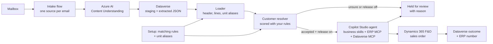

# Sales Order Agent

Turn sales order documents that arrive by email into verified sales orders in Dynamics 365 Finance and Operations.

The agent reads the order from a PDF, Word or Excel file, an image, or the email body itself. It extracts the header and every line with Azure AI Content Understanding, finds the right customer across every company with rules you configure, and has a Copilot Studio agent validate the customer and products and create the order in the ERP. Every customer decision is logged with its score, margin and reason, so a person can always see why an order was accepted or held.

This is version 1.2 of the template. The earlier version is in the [Sales Order Agent](../Sales%20Order%20Agent/readme.md) folder.

## Start here

| I want to... | Go to |
| --- | --- |
| Install it in a test environment | [Quick start](docs/quick-start.md), then the full [Deployment guide](docs/deployment-guide.md) |
| Use it day to day (review orders, fix a held order) | [User guide](docs/user-guide.md) |
| Change how customers are matched | [Customer Matching Rules](docs/customer-matching-rules.md) |
| Look at or change the extraction analyzer | [Content Understanding analyzer guide](docs/content-understanding-analyzer-guide.docx) |
| Check what my security team must approve | [DLP and security requirements](docs/dlp-and-security-requirements.md) |
| Understand the design | [Architecture](docs/architecture.md) |
| Find an answer fast | [FAQ](docs/faq.md) |
| See what changed | [Release notes](docs/release-notes.md) and [CHANGELOG](CHANGELOG.md) |

## What changed from V1.0 to V1.2

| | V1.0 | V1.2 |
| --- | --- | --- |
| Agent | Standard Copilot harness | More reasoning, driven by Dataverse business skills and the new Copilot harness |
| Orchestration | Power Automate in a rigid, tightly coupled workflow | The agent validates and creates the order with the ERP MCP and the Dataverse MCP |
| Extraction | AI Builder prompt, limited in the number of documents and the document types it could process | Azure AI Content Understanding with a field schema, so a new layout usually needs no change |

V1.2 also adds configurable customer matching with a logged decision for every order, an editable unit-of-measure alias list, and guarded release. See the [release notes](docs/release-notes.md).

## Supported document formats

| Source | Notes |
| --- | --- |
| PDF | Default minimum size is 4096 bytes |
| Word (DOCX) | |
| Excel (XLSX) | Test your own workbook layouts first; support depends on the analyzer for each file |
| Images (PNG, JPG and similar) | |
| Email body | Needs the line items in a table; a body that lists items without a table stops for manual handling |

The intake accepts one source per email: a supported attachment if there is one, otherwise the body. An accepted file extension is not a guarantee that every layout is read correctly, so test representative originals of each kind you plan to process. Send one order per document.

## How it works



## Built to hold, not to guess

* A customer is accepted only when the full search completed, the score reaches the threshold, the lead over the next candidate reaches the margin, and the saved proof is current. Anything else is held with a reason code.
* Release is a switch. Matched orders stay held until you turn it on, and it ships off.
* The agent validates an order only from status **New**, and creates an ERP order only when none exists yet.
* A run that stops on a guard is recorded as **Cancelled** and leaves the order unchanged, so it can be re-run.
* Finance and Operations calculates every price. Prices printed on the document are stored for audit only.
* A flow step that shows Succeeded is not treated as success. The result is confirmed from Dataverse and the ERP.

## Who this is for

* **Dynamics 365 F&O and Power Platform partners and administrators** who install and operate the template.
* **Sales operations teams** who review held orders and keep the matching rules and unit aliases up to date.
* **Architects and security teams** who assess the design, the connectors and the data flow.

## What you need

* An Azure subscription with Azure AI Content Understanding and permission to deploy the analyzer.
* A Power Platform environment with Dataverse and Copilot Studio, and System Administrator rights for the installer.
* Dynamics 365 Finance and Operations with an integration account that can read customers and products and create sales orders.
* An isolated mailbox and folder for testing.
* PowerShell 7 or later and the Azure CLI.

## Repository contents

```
PowerPlatform/             Managed solution, first-time setup script, deployment settings template
azure-content-understanding/  Analyzer definition and its deploy and test scripts
docs/                      Quick start, deployment guide, user guide, matching rules, FAQ, DLP and security, architecture
SHA256SUMS.txt             Checksums of the solution, analyzer and script files
```

Verify the checksums before you import.

The solution ships **managed**, for test and production. Its components are customizable: make your own changes in an unmanaged layer or solution in your environment, and record them so you can reapply them after an upgrade.

## Support

Raise an issue in this repository. Do not post customer data, mailbox contents, keys or connection secrets. The guide lists what to collect for a useful report (deployment guide, section 13).
