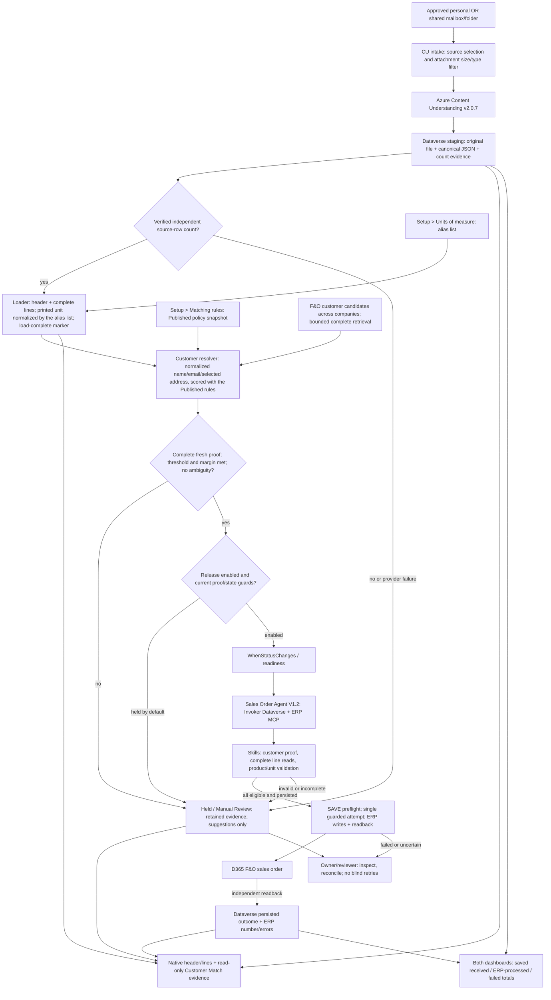

# Sales Order Agent architecture - 1.0.9.0

Date: 2026-11-03. Content Understanding analyzer `sales_order_extraction_v2_0_7`, native Information form plus
Customer Match, two dashboards, configurable customer matching with a Setup screen, unit-of-measure aliases, and
guarded business-agent processing.

## Boundaries and contracts

| Boundary | Contract and failure behavior |
|---|---|
| Mail to intake | One configured source route per mailbox/folder; surviving attachments or email body, not both. Default minimum 4096 bytes; small-PDF exception off. Extension acceptance is not analyzer format certification. |
| Intake to CU | Correct target resource/authentication and current analyzer pointer; preserve original bytes/operation evidence. Provider failure must not become extracted business data. |
| CU to loader | Persist canonical JSON and source-row/count verification. Count equality is necessary, not a guarantee of correct fields. |
| Loader | Persist complete header/lines and the explicit source ShipTo separately from the operational address fallback. Normalize the printed unit with the alias list; the extraction JSON keeps the unit as printed. Do not dispatch on a partially loaded header. |
| Loader to resolver | Resolver starts only for a completely loaded header. |
| Resolver to proof consumers | Complete candidate and policy reads, normalized proof, source/policy freshness and persisted read verification. Missing, stale or malformed proof fails closed. |
| Matching rules | Exactly one Published policy per key; the resolver reads its snapshot on every run. A rule change while an order is in flight stops that order for review. |
| Address selection | An address basis that is part of the Published policy. BillTo compares the invoice address; ShipTo compares an explicit source address with a valid ERP default delivery address. No try-both or fuzzy auto-accept. |
| Agent to ERP | Invoking-user permissions, matched company/customer, current guarded state, complete line reads and product/unit preflight. The agent validates only from status New and creates an ERP order only when no ERP number exists. The existing duplicate lookup is not transactional. |
| Guard stops | A run that stops because the proof, the matching rules or the load state changed is recorded as Cancelled and leaves the order unchanged for re-run. |
| ERP to completion | Persist the actual outcome and verify ERP data, not just tool prose/status. Partial or uncertain writes require reconciliation before replay. |
| UI | Original native editable controls retained; matching evidence viewer read-only. Dashboards summarize accessible saved records. |

## Deployment state

Shared intake and the resolver's `ReleaseHeaders` ship stopped/false. Those controls are part of the package and are
not permission to activate processing in a target. Connections, API/Entra base-resource bindings and actual Invoker
access do not travel as usable credentials in a solution ZIP, and the resolver's ERP host name is set per target.
No Azure Function or custom connector is required by this CU route.

See the [deployment guide](./deployment-guide.md), [DLP requirements](./dlp-and-security-requirements.md),
[Customer Matching Rules](./customer-matching-rules.md) and the [FAQ](./faq.md).
