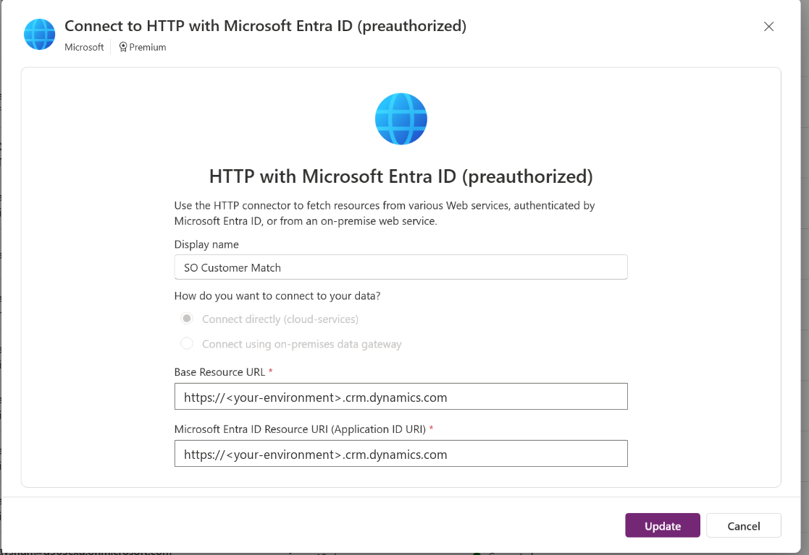

# Sales Order Agent V1.2

Deployment Guide - Release 1.1.0.0

24 November 2026

Start with Part A and work through Parts B-F in order. Complete every step in a test environment before connecting a production mailbox.

**What release 1.1.0.0 adds**

* **Reviewer overrides** (section 9.12). When two customers tie, a reviewer can type the ERP customer number and company code, give a reason, set Valid Customer to Yes and set the order status to Valid; the agent then validates every line and creates the order. A reviewer can also decide a single line (ERP product code, Manual Override, reason). Decisions are saved with who, when and why, and the ERP checks at creation still apply.
* **New columns:** Customer Override Reason and Original Match Evidence on the order, Manual Override and Override Reason on the order line. The order form and the line form show them.
* **Every component of the managed solution is customizable**, and the build fails if one is locked.
* **The release switch is the environment variable `aipod_ReleaseHeaders`** (section 5), set under Environment variables like the other settings. It ships `false`; set it to `true` to release accepted matches after the checks in section 8 pass.

Upgrading from 1.0.10.0: see section 11.1.

**What release 1.0.10.0 fixed**

* **The Finance and Operations host is now an environment variable** (`aipod_FinanceOperationsInstance`, section 5). In earlier releases it was a flow parameter with the placeholder `your-environment.operations.dynamics.com` that could not be edited in the designer, so turning the resolver flow on failed with a BadGateway error. The variable ships empty: until you set it, customer matching stops with `CustomerMatchConfigurationMissing` instead of calling a host that does not exist.
* **The agent's own notification emails are no longer read as orders.** Both intake flows skip any email whose subject contains `Sales Order Agent - `, so a notification that lands in the monitored folder can no longer be processed as a new order and trigger another notification.
* **Connection binding is documented** (section 4.3): which connection reference each flow needs, and what `ConnectionAuthorizationFailed` means.

Upgrading from 1.0.9.0: see section 11.1.

**What release 1.0.9.0 added**

* **Configurable customer matching.** Rules (points, threshold, margin, address basis, fallback and name switches) are edited under **Setup > Matching rules** and take effect on the next order, with safety floors that cannot be lowered. See [Customer Matching Rules](customer-matching-rules.md) and sections 5.2 and 9.10.
* **Unit-of-measure aliases.** The printed unit (EA, EACH, PCS, Pc, E and others) is normalized by an editable alias list under **Setup > Units of measure**. See section 5.3.
* **Guarded release.** An order is validated only from the status New, an ERP order is created only when no ERP number exists yet, and a run that stops on a guard is recorded as Cancelled. See section 9.11.
* **Agent model requirement.** The agent is configured for the Claude Sonnet model; Auto is the alternative. See section 6.2.
* **Order overview dashboards** load their totals tile from the solution itself, so they work in any environment.
* **First-time setup script** (`Initialize-SalesOrderAgent.ps1`) adds the first matching policy, the starter unit aliases and the reader field security in one step. See section 7.2.

## 1. What this solution does

The solution reads sales order documents that arrive by email, extracts the order content using Azure AI Content Understanding, stages the result in Microsoft Dataverse, and creates a sales order in Dynamics 365 Finance and Operations after validation by a Microsoft Copilot Studio agent.

Processing sequence:

1. A monitored mailbox receives an email.

2. A cloud flow selects exactly one source from the email: a supported attachment if one is present, otherwise the email body. Never both.

3. Azure AI Content Understanding analyses that source and returns structured order data.

4. The flow writes the original file and extracted JSON to a staging record, verifies source-row completeness, normalizes the printed unit of measure, and creates the sales order header and lines in Dataverse.

5. The customer resolver scores complete cross-company candidates against the Published matching rules and retains the evidence. A match that meets every rule is accepted; anything else stays held for review. An approved release must pass the current proof and state guards before the Copilot Studio agent validates products.

6. After customer, product and complete-line validation, the agent creates the sales order in Dynamics 365 Finance and Operations and verifies the persisted result.

The intake routes are configured for PDF, Word, Excel, common image formats and HTML email bodies. An allowed extension is not proof of analyzer support for every format or layout; test representative original documents of each kind you intend to process.

## 2. Before you begin

You need the following. Obtain all of them before starting; several steps cannot be completed without them.

| Requirement | Detail |
| --- | --- |
| Azure subscription | Active subscription, Microsoft.CognitiveServices registered, supported region and model quota |
| Azure AI Foundry resource | Endpoint and management/data-plane permissions for Content Understanding |
| Power Platform environment | Dataverse provisioned, Dataverse search ON, import rights and approved capacity/licenses |
| Power Platform role | Authorized installer (System Administrator for the first-time setup); separately approved and tested least-privilege runtime/reviewer identities |
| Copilot Studio | Licensed/enabled; actual agent shared with the runtime identity; the Claude Sonnet model available (or use Auto, section 6.2) |
| Dynamics 365 F&O | Correct target instance, permitted legal entities, read and test-create/readback rights |
| Mailbox | Isolated test mailbox/folder before production; shared-mailbox rights where needed |
| Tooling | PowerShell 7 or later and Azure CLI signed into the resource's tenant/subscription |
| DLP and operations | Approve all six connectors, endpoint restrictions, retention/auditing and support/recovery ownership |

Package contents:

| File | Purpose |
| --- | --- |
| PowerPlatform/SalesOrderAgentProcessingTemplateV12_1_1_0_0_managed.zip | Managed solution for test and production environments. Its components are customizable (section 10.9). |
| PowerPlatform/Initialize-SalesOrderAgent.ps1 | First-time data setup (section 7.2). |
| PowerPlatform/deployment-settings.template.json | Connection references and environment variables to fill in for a command-line import. |
| azure-content-understanding/ | Analyzer v2.0.7 definition plus Deploy-Analyzer, Test-AnalyzerContract and Test-CuReadiness scripts |
| docs/ | This guide, Customer Matching Rules, release notes, FAQ, architecture and DLP/security guidance |
| SHA256SUMS.txt | The SHA-256 of the solution, analyzer and script files |

## 3. Part A — Deploy the Azure Content Understanding analyzer

The analyzer is the extraction model. It must exist before the solution is imported, because the solution refers to it by identifier.

### 3.1 Create the Azure AI Foundry resource

1. Sign in to the Azure portal.

2. Create a resource of type Azure AI Foundry (Azure AI Services).

3. Choose a region that supports Content Understanding.

4. After deployment, open the resource and copy its endpoint. It has the form shown below. Record it as ENDPOINT.

```powershell
https://<your-resource-name>.services.ai.azure.com
```

IMPORTANT  Use the services.ai.azure.com endpoint. The cognitiveservices.azure.com form exists on the same resource but does not serve Content Understanding and returns HTTP 404.

### 3.2 Grant yourself access

An Azure administrator with Owner, User Access Administrator or Role Based Access Control Administrator rights assigns these roles to the identity that will run the deployment script:

| Role | Scope | Used for |
| --- | --- | --- |
| Cognitive Services Contributor | Resource group (or the resource) | Find the resource and create the model deployments |
| Cognitive Services User | The Azure AI Foundry resource | Configure Content Understanding, create and replace the analyzer, run the contract test |

1. Open the resource group or resource, then Access control (IAM), and add both role assignments.

2. Allow a few minutes for the assignments to take effect.

Both roles are required. Cognitive Services Content Understanding Owner may replace Cognitive Services User. Content Understanding Contributor is not sufficient to replace an existing analyzer (-Force), because it cannot delete analyzers.

Also confirm: the Azure subscription is Active, Microsoft.CognitiveServices is registered, GlobalStandard quota exists for gpt-4.1 and text-embedding-3-large in the region, local key authentication is enabled for the supplied key-based runtime connection, and network rules admit Power Platform. A resource showing Succeeded does not prove subscription or service readiness.

You do not need to deploy models or configure Content Understanding in the portal. The script in 3.3 does both.

### 3.3 Deploy the analyzer

1. Open PowerShell and sign in to the Azure CLI. If you have more than one subscription, select the one that contains the resource.

```powershell
az login
az account set --subscription <subscription-id>
```

2. Change to the azure-content-understanding folder of this package.

3. Optional: preview every change without making it.

```powershell
.\Deploy-Analyzer.ps1 -Endpoint https://<your-resource-name>.services.ai.azure.com -WhatIf
```

4. Run the deployment script, substituting your endpoint.

```powershell
.\Deploy-Analyzer.ps1 `
    -Endpoint https://<your-resource-name>.services.ai.azure.com
```

5. Confirm the script reports: RESULT: Deployed - status ready.

Before creating the analyzer, the script prepares the resource:

6. Reuses existing gpt-4.1 and text-embedding-3-large deployments, or creates them as GlobalStandard deployments with capacity 100.

7. Sets the Content Understanding defaults that map those models to the deployments. A new resource rejects every analyzer with the error DefaultsNotSet until this is done.

The script authenticates with your Entra identity. It does not use and does not store an API key. It is safe to re-run; it reuses existing deployments and reports no change when the analyzer already exists.

IMPORTANT  If deployment creation fails with a quota error, rerun with a lower -CompletionCapacity and -EmbeddingCapacity, or request GlobalStandard quota for gpt-4.1 and text-embedding-3-large in your region. To manage deployments yourself, create them first and add -SkipResourcePreparation.

IMPORTANT  Analyzer identifiers accept letters, digits, dots and underscores only. Hyphens are rejected by the service.

Analyzer v2.0.7 preserves printed line numbers and otherwise numbers lines 1..N in document order. It extracts the Ship To address separately from the Bill To address. It does not extract productcoderaw; the intake flow derives it from productcode. Earlier analyzer versions are not supported with this release.

### 3.4 Verify the analyzer contract

1. Run the contract test against the analyzer you just deployed.

```powershell
.\Test-AnalyzerContract.ps1 `
    -Endpoint https://<your-resource-name>.services.ai.azure.com `
    -AnalyzerId sales_order_extraction_v2_0_7 `
    -SampleDocument C:\ApprovedTests\sample-order.pdf
```

2. Confirm the result shows FAIL = 0. Do not continue if any check fails.

## 4. Part B — Import the Power Platform solution

### 4.1 Create the connections first

Create these connections in the target environment before importing. The import asks you to map each one, and the list is easier to complete when the connections already exist.

| Connection | Used for | Sign in as |
| --- | --- | --- |
| Office 365 Outlook | Read the intended mailbox and send configured notices | Mailbox owner/delegate with required rights |
| Microsoft Dataverse | Staging/header/line persistence and agent MCP | Approved runtime identity for the target organization |
| Azure AI Content Understanding | Document extraction | Key-based connection for the target resource; see below |
| Fin & Ops Apps (Dynamics 365) | Resolver customer reads and agent ERP MCP | Integration identity with permitted legal entities |
| Agents / Microsoft Copilot Studio | WhenStatusChanges invokes the actual business agent | Identity allowed to invoke Sales Order Agent V1.2 |
| HTTP with Microsoft Entra ID (preauthorized) | Read the matching rules and saved matching evidence in the target Dataverse environment | Dedicated connection bound to `aipod_sharedwebcontents_customermatch`; see "HTTP with Microsoft Entra ID connection" below |

Azure AI Content Understanding connection:

1. Create the connection and choose key-based authentication.

2. Supply the endpoint recorded in step 3.1 and one of the two keys from the Azure resource.

IMPORTANT  This connection uses key-based authentication. If you rotate the key in Azure, the connection continues to display Connected while every call fails. Always update the connection immediately after a rotation, then process one document to confirm.

HTTP with Microsoft Entra ID connection (customer matching):

Four flows read the matching rules and the saved matching evidence from your own Dataverse environment through this connection: SOA - Resolve Customer Company Exact V1, SOA - Publish Customer Match Policy V1, WhenStatusChanges and Update Processing Status to Valid. It is the only connection that needs your environment's URL, and the solution cannot fill it in for you. Create it before the import so you can map it to the connection reference `aipod_sharedwebcontents_customermatch`.

1. Find your Dataverse environment URL. In the Power Platform admin centre open **Environments**, select the target environment and copy the **Environment URL**. It has the form shown below, with no trailing slash and nothing after `.dynamics.com`.

```powershell
https://<your-environment>.crm.dynamics.com
```

2. In Power Automate (make.powerautomate.com) select the **target** environment, then **Connections** > **New connection**.

3. Search for **HTTP with Microsoft Entra ID (preauthorized)**. It is a premium connector.

4. Enter the values in the table below, as shown in Figure 1.

| Field | Value |
| --- | --- |
| Display name | A name you will recognize, for example `SO Customer Match` |
| How do you want to connect to your data? | **Connect directly (cloud-services)** |
| Base Resource URL | The environment URL from step 1 |
| Microsoft Entra ID Resource URI (Application ID URI) | The same environment URL as Base Resource URL |



5. Select **Create** and sign in as the identity that owns the flows (section 7.1 and the DLP and Security Requirements). That identity needs Read access to the **Customer Match Policy** table and to the sales order header table, including the customer match evidence, and the **Customer Match Policy Reader** field security profile.

6. To correct a connection that already exists, for example after moving to another environment, open it in **Connections**, select **Edit**, change both URL fields, and select **Update**. The edit form is different from the create form: it has no "How do you want to connect" choice, and the authentication type is fixed as "Log in with Microsoft Entra ID". That is expected. Remove any trailing slash from both URLs before selecting **Update**.

IMPORTANT  Both URL fields must name the **target** environment. A connection that still points at another environment makes the flows read that environment's rules and evidence, or fail. Do not reuse a connection copied from another environment, and do not add a path or a trailing slash.

IMPORTANT  A connection can be used to turn a flow on only by the person who owns it. If the flow reports `ConnectionAuthorizationFailed`, create the connection while signed in as the person who will turn the flows on (or have the connection's owner turn them on). See section 4.3.

During the import (section 4.2), map `aipod_sharedwebcontents_customermatch` to this connection. If you imported without it, open the solution, select **Connection references**, open `aipod_sharedwebcontents_customermatch` and choose the connection.

The first policy publish in section 7.2 exercises this connection. If the policy is not published, or orders stop with `CustomerMatchPolicyUnavailable`, check the two URLs first, then the signed-in identity's access.

IMPORTANT  Required connector IDs are shared_office365, shared_commondataserviceforapps, shared_contentunderstanding, shared_dynamicsax, shared_agentnode and shared_webcontents. Admin must review every applicable DLP policy; normally classify the required connectors compatibly in Business. Do not weaken tenant-wide policies or treat a permissive second policy as overriding a restrictive one.

### 4.2 Import

1. Open the Power Platform admin centre and select the target environment.

2. Go to Solutions, then Import solution.

3. Select SalesOrderAgentProcessingTemplateV12_1_1_0_0_managed.zip for a test or production environment.

4. Map every connection when prompted. Do not leave any unmapped.

5. Supply the target environment-variable current values listed in section 5, including `aipod_FinanceOperationsInstance`.

6. Start the import and wait for it to complete.

7. Confirm the solution appears with version 1.1.0.0. Record the import job ID and inspect warnings/dependencies before enabling anything.

IMPORTANT  Import success does not mean the solution works. Sections 5 to 8 contain steps that the import cannot perform, and the solution will not process a single document until they are complete.

### 4.3 Bind every connection reference to the connections of the person who turns the flows on

A flow can be turned on only with connections that the person turning it on owns. Imports often map the references to whoever imported, so bind all of them before turning anything on, instead of fixing one error at a time. Open the solution, select **Connection references**, open each reference below and choose (or create) the connection of that connector.

| Connection reference | Connector | Used by |
| --- | --- | --- |
| `aipod_salesorderagentv1.2_…shared_dynamicsax…` | Fin & Ops Apps (Dynamics 365) | SOA - Resolve Customer Company Exact V1 |
| `aipod_sharedwebcontents_customermatch` | HTTP with Microsoft Entra ID (preauthorized) | Resolver, Publish Customer Match Policy V1, WhenStatusChanges, Update Processing Status to Valid |
| `aipod_sharedcommondataserviceforapps_02e02` | Microsoft Dataverse | Loader, both publish flows, both Notify flows, both intake flows, Update Processing Status to Valid, Reprocess |
| `aipod_sharedcommondataserviceforapps_294c8` | Microsoft Dataverse | WhenStatusChanges |
| `crde4_aipod.cr.shared_commondataserviceforapps…` | Microsoft Dataverse | WhenStatusChanges |
| `new_sharedagentnode_1b241228` | Agents / Microsoft Copilot Studio | WhenStatusChanges |
| `new_sharedcontentunderstanding_64342` | Azure AI Content Understanding | Both intake flows |
| `new_sharedoffice365_deb36` | Office 365 Outlook | Both intake flows, both Notify flows |

The solution also lists other connection references that no flow uses; leave them as they are.

If a flow still will not turn on with `ConnectionAuthorizationFailed`, the message names the reference. Open that reference, choose a connection you own, save, and turn the flow on again.

## 5. Part C — Environment variables

The package contains no environment-variable current values, so every environment-specific setting must be supplied for the target. Safe defaults, including the analyzer identifier, Inbox, false for small PDFs and the starter unit alias list, remain where defined; do not clear them.

| Variable | Required | Value to supply |
| --- | --- | --- |
| aipod_AzureContentUnderstandingAnalyzerId | Yes | sales_order_extraction_v2_0_7; shipped definition default |
| aipod_AllowSmallPdfAttachments | No | false by default; change only after explicit approval and a test with an original document |
| aipod_CompanyCode | Where consumed | Target legal entity for remaining consumers; not an override of the resolver's per-order matched company |
| aipod_MailboxToMonitor | Personal route | Intended mailbox; no overlap with another active route |
| aipod_MailboxFolderToMonitor | Personal route | Existing folder; Inbox default or intended subfolder |
| aipod_ReviewerEmailAddress | Yes | Approved reviewer/support recipient; verify actual notification delivery. The agent's notification emails (subject contains `Sales Order Agent - `) are skipped by intake, but a separate reviewer address or folder is still the cleaner setup |
| aipod_UomAliasMap | No | Shipped with the starter list of 66 unit aliases. Do not edit it by hand: it is maintained from Setup > Units of measure (section 5.3) |
| aipod_SharedMailboxToMonitor | Shared route only | Shared mailbox address; keep the shared route stopped until approved |
| aipod_SharedMailboxFolderToMonitor | Shared route only | Existing shared mailbox folder; both shared variables required |
| aipod_FinanceOperationsInstance | Yes | Host name of the target Finance and Operations environment, for example contoso.operations.dynamics.com. No https:// and no trailing slash. Ships empty: while empty, customer matching stops with `CustomerMatchConfigurationMissing` |
| aipod_ReleaseHeaders | No | The release switch. Ships `false`: accepted customer matches are held (`CustomerMatchReleaseDisabled`). Set the Current Value to `true` to release accepted matches to the agent and the ERP, only after the checks in section 8 pass. Only the text `true` releases; any other value holds the orders |

To change a value after import, open the target solution, select the environment variable and set its Current Value. Keep environment-specific values out of the shipped solution.

The intake flows read their configured mailbox, folder, analyzer and small-PDF settings from these variables. Review resolved values under the actual runtime identity. If a change requires a flow refresh, keep the affected route stopped until the controlled activation in section 7; do not toggle production intake during setup.

### 5.1 Connections and settings outside the environment variables

The eleven variables in this section are the only environment-variable definitions in the package. Bill-To or Ship-To matching is **not** a variable: it is the **Address basis** of the Published matching policy (section 5.2). The following are configured in their own surfaces:

| Setting | Where to configure and verify |
| --- | --- |
| CU endpoint and key | Azure AI Content Understanding connection; use the services.ai.azure.com endpoint and matching target credential. |
| Dataverse / ERP MCP | Agent tool connection references and invoking-user consent/permissions; use connections that belong to the target environment. |
| Matching HTTP/Entra connection | The connection created in section 4.1 (both URL fields hold the target Dataverse environment URL), mapped to `aipod_sharedwebcontents_customermatch`; verify under the actual runtime identity. |
| F&O host | The environment variable `aipod_FinanceOperationsInstance` (table above). It ships empty. Set the host name of the target Finance and Operations environment only, for example contoso.operations.dynamics.com, without https://. Until it is set, customer matching stops with `CustomerMatchConfigurationMissing`. |
| Release switch | The environment variable `aipod_ReleaseHeaders` (table above). It ships `false`, a safety switch: keep it `false` until the checks in section 8 pass, then set the Current Value to `true`. Releases before 1.1.0.0 had it as a resolver flow parameter that the portal does not show. |
| Publish flows' connections | "SOA - Publish Customer Match Policy V1" and "SOA - Publish Unit Alias Map" need a Dataverse connection owned by a System Administrator, because the second writes an environment variable value. |

How matching works in brief. Each candidate customer in every legal entity is scored on name, email and address. BillTo mode compares the document's billing party and address with the ERP invoice address; ShipTo mode needs an explicit ShipTo address on the document and a valid ERP default delivery address, and it never substitutes the Bill-To address as ShipTo evidence. A customer is accepted only when candidate retrieval was complete, the score reaches the threshold, the lead over the next candidate reaches the margin, and the saved proof is current. Ties across companies and fuzzy suggestions are held for review and can never authorize ERP processing. The points, threshold and margin come from the Published matching rules (section 5.2); the standard values are name exact 40, name contains 20, email 15, street 10, ZIP 20, city 10 and state 5, threshold 70 and margin 15.

### 5.2 Configurable customer-matching rules

* Rules live in the **Customer Match Policy** table and are edited under **Setup > Matching rules** in the Sales Order Agent app. Only users with Write permission on that table see Setup: the **Sales Order Matching Administrator** role and System Administrators. Sales Orders Reviewers keep read-only evidence on each order's Customer Match tab.
* The engine uses only the **Published** version of the policy whose key is `default`. A new version is created by adding a row, setting **Publish request** to Yes and saving; the publish flow validates it, publishes it and retires the previous version.
* Standard values: name exact 40, name contains 20, email 15, street 10, ZIP 20, city 10, state 5 (these six primary values total 100), threshold 70, margin 15, fallback address off. Safety floors that cannot be lowered: threshold at least 60, margin at least 10, name-contains length at least 5, and no single group can reach the threshold alone. Full rules, examples and reason codes: [Customer Matching Rules](customer-matching-rules.md).
* The address basis (Bill-To or Ship-To) is a property of the Published policy; choose it when the first policy is created (section 7.2).
* Every field has a hover tooltip and the **How matching works** tab explains the rules with live numbers for the values being edited.

What the solution already contains: the policy table and columns, the publish flow, the Setup screens (form, views, menu entries), the two roles and the field security profiles.

What you do in a new environment, in this order:

1. Import the solution and create the connections (Parts B and C).
2. Turn on the publish flow and run the first-time setup script (sections 7.1 and 7.2). The script creates and publishes the first `default` policy and assigns the reader field security to the business-unit default teams.
3. Assign **Sales Order Matching Administrator** to the people who may change rules. Do not give it to reviewers.
4. Set the environment variable `aipod_FinanceOperationsInstance` (section 5) and keep `aipod_ReleaseHeaders` at `false` until the controlled release in section 8.

### 5.3 Unit-of-measure normalization

Documents print units in many ways (EA, EACH, PCS, Pc, E). The loader flow normalizes the printed unit before it writes the order line, so the validation and ERP steps see one consistent value.

* **Where you maintain it:** **Setup > Units of measure > Unit aliases** in the Sales Order Agent app (Dataverse table *Unit alias*). Each row is one alias: **Printed as**, **Becomes**, Unit class (list grouping only), Active and a reason for the change. The starter list has 66 aliases: count units (ea, each, eaches, eac, e, pc, pcs, piece, pieces become `ea`) and common case, box, pack, dozen, pair, roll, set, kit, pound, ounce, foot, yard, metre, gallon and litre spellings. The same list ships as the default of the variable **aipod_UomAliasMap**, so it is in effect before any row exists.
* **Saving a row publishes it.** The flow *SOA - Publish Unit Alias Map* checks every active row (no blank or duplicate aliases, map under 2,000 characters) and then writes the JSON into the environment variable **aipod_UomAliasMap**, which the loader flow reads. The row shows **Published**. If a check fails, the row shows **Rejected** with the reason, the map in use does not change, and the row appears under **Needs attention**. There is no separate draft step: a valid row is live a minute or two after you save it, and it applies to orders loaded afterwards. Orders already loaded are not changed.
* Matching ignores case and periods (`PCS.`, `Pcs` and `pcs` are one alias). A unit that is not in the list is kept exactly as printed.
* **Try a printed unit** (same menu) shows what a printed unit becomes and, if you enter the item's ERP unit, whether the order can continue.
* Use **Active = No** to stop using an alias. Deleting a row also removes it from the map; the Matching Administrator role cannot delete, so use Active = No.
* The extraction JSON keeps the unit as printed; only the order line receives the normalized value, so the original is always available for audit. No flow, skill, analyzer or Content Understanding change is needed to add or change an alias.
* Do not edit the variable's Current Value by hand: the next publish replaces it with the rows.
* The `create-sales-order` skill treats the count units ea, each, pc, pcs, piece and pieces as the same unit and sends the item's own ERP sales unit symbol to the ERP, so `ea` on the order line becomes the item's ERP unit (for example `pcs`). There is no quantity conversion. For every other unit the value in **Becomes** must equal the item's ERP sales unit symbol (case-insensitive); for example `Case` and `Box` are accepted only for items whose ERP symbol is literally `Case` or `Box`, and any other mismatch goes to Manual Review with `UnitOfMeasureMismatch`. Set **Becomes** to the symbol your ERP uses (for example `cs` to `CS`). Test each mapping you add with **Try a printed unit** and one sample document before relying on it.
* **Roles:** the *Sales Order Matching Administrator* role gets Create, Read, Write, Append and Append To on the table (no Delete); the Setup menu appears only for users with Write.
* **In a new environment:** the table, flow, screens and variable come with the solution. Turn on the publish flow (section 7.1) and run the first-time setup script (section 7.2); it adds the starter aliases to the table, and the flow publishes them.

## 6. Part D — Attach the business skills and publish the agent

IMPORTANT  This section is mandatory and is not performed by the solution import. If you skip it the agent reports that a skill is unavailable, and no order reaches the ERP even though every other step reports success.

1. Open Microsoft Copilot Studio and select the target environment.

2. Open Sales Order Agent V1.2, the business agent included in the solution. Do not select a similarly named parser agent.

3. Open the agent's tools or skills configuration.

4. Attach the three business skills shipped in the solution: the customer validation skill, the product validation skill, and the sales order creation skill.

5. Confirm the Dataverse MCP and ERP MCP tools have the correct target connection bindings and invoking-user access. Confirm the status flow's Agents connection can invoke this agent as its actual runtime identity.

6. Publish the agent.

7. Wait for publication to complete. Keep intake and ERP dispatch held; publication or the agent's own description is not proof that the skills execute successfully.

### 6.1 Prove the skills resolve

Before processing a real document, confirm capabilities under the actual runtime identity. Retain read-only operation results; do not treat an agent's self-description as proof.

1. In the test pane, ask the agent to describe its available skills.

2. Confirm all three skills are present and none reports unavailable; verify actual read-only access to the persisted skill/configuration records and the target Dataverse and ERP tools.

3. Run one read-only Dataverse operation and one read-only ERP operation.

4. Only then continue to the held processing checks. A successful read-only probe does not authorize an ERP write.

### 6.2 Agent model

The agent in the solution is configured for the **Claude Sonnet** model. The business skills only work when the model reads each skill body and then calls the Dataverse and ERP tools the skill names. Use one of these two settings:

* **Claude Sonnet** (the shipped setting), or
* **Auto**.

If Claude Sonnet is not offered in your environment, open the agent in Copilot Studio, go to Settings > Generative AI, choose **Auto**, publish the agent and repeat section 6.1. Do the same after any change of model.

Do not select a different model without running the held checks in section 8 first. A model that does not call the ERP tool makes validation stop with a product-lookup failure even though the flow run shows Succeeded and the agent answers normally.

## 7. Part E — Activate the flows and run the first-time setup

Keep target intake and dispatch stopped while importing, binding and configuring. Imported flows must not be assumed to be safe to turn on; turn on only what each step below names.

### 7.1 Turn on the two publish flows

"SOA - Publish Customer Match Policy V1" and "SOA - Publish Unit Alias Map" react only to rows in their own tables. They do not read mail or touch orders.

1. Bind their connections (section 5.1). The policy publish flow also uses the HTTP with Microsoft Entra ID connection from section 4.1. The unit alias flow needs a Dataverse connection owned by a System Administrator.

2. Turn both flows on and confirm each shows On.

### 7.2 Run the first-time setup script

The solution carries no data. The script in the PowerPlatform folder of the package adds what a new environment needs: the first Published matching policy, the starter unit aliases, and the reader field security for the business-unit default teams. Run it as a System Administrator of the target environment, from PowerShell 7 with the Azure CLI signed in. If PowerShell reports that the script "is not digitally signed", first run `Unblock-File .\Initialize-SalesOrderAgent.ps1` (a downloaded file is marked as coming from the internet), or see the troubleshooting table in section 12.

```powershell
az login
.\Initialize-SalesOrderAgent.ps1 -EnvironmentUrl https://<your-env>.crm.dynamics.com
.\Initialize-SalesOrderAgent.ps1 -EnvironmentUrl https://<your-env>.crm.dynamics.com -Apply
```

The first command only reports what it would do. Add `-AddressBasis ShipTo` to the second for an environment that matches customers on the Ship-To address (the default is BillTo). The script can be run again; anything that already exists is left alone. If it reports that the policy was not published, check that the publish flow is On with its connection bound, then run it again.

Confirm the result in the Sales Order Agent app: **Setup > Matching rules** shows one Published row with key `default`, and **Setup > Units of measure** lists 66 aliases, each showing Published within a minute or two.

### 7.3 Turn on the processing flows

1. Open Cloud flows and confirm the exact intended mailbox/folder, target connections, DLP approval, permissions, reviewer routing and the Published matching rules.

2. In an isolated target with no queued customer documents, enable only the loader and resolver needed for held validation. Keep `aipod_ReleaseHeaders` at `false`. Verify complete loading and customer-match evidence without an ERP write.

3. After the owner approves a controlled test, enable the status and readiness flows. Current proof, load-complete and state guards must pass; never force New or Valid to bypass them.

4. Enable only the intended test intake after the held checks and test execution plan are ready. Complete section 8 before any production activation; a production release requires separate owner sign-off.

5. Leave unused routes stopped. Choose personal or shared routing for the intended mailbox and do not point overlapping active intake flows at the same mailbox/folder.

IMPORTANT  Activating two intake flows that monitor the same mailbox and folder causes every email to be processed twice, producing duplicate orders.

## 8. Part F — Verify the installation

Perform this verification in a controlled mailbox before connecting a production mailbox.

### 8.1 Readiness check

1. Run the readiness script from the azure-content-understanding folder.

```powershell
.\Test-CuReadiness.ps1 `
    -OrgUrl https://<your-env>.crm.dynamics.com `
    -Endpoint https://<your-resource-name>.services.ai.azure.com
```

2. Resolve every reported failure before continuing. Readiness PASS alone does not establish current customer-match proof, target DLP, actual runtime permissions or ERP readiness.

### 8.2 End-to-end test

1. With explicit approval for test ERP order creation, send one single-order document to the isolated test mailbox. Check file eligibility first; do not pad a small PDF or change source expectations to manufacture a pass.

2. Confirm the intake flow ran and produced one staging record.

3. Read back the staging record and exact persisted JSON. Compare source header fields and every printed line's identifier, item, quantity, unit, price and total. Confirm the Dataverse header and complete line set; count equality alone does not validate field accuracy.

4. Confirm accepted matching evidence identifies the correct legal entity/customer and is current. Confirm the actual agent validates every product/line. Ambiguous, stale or incomplete evidence must remain held.

5. After the separately approved guarded release, confirm Dataverse shows Processed with an ERP number and independently open/read that order in Dynamics 365 F&O.

6. Confirm company, customer, PO, requested-date outcome and the complete item/quantity/resolved-unit/site/warehouse line multiset match the persisted validated order. Do not depend on ERP line order.

7. Confirm Finance and Operations calculated the prices from its own configuration. Do not compare ERP prices with printed document prices: the creation skill does not send SalesPrice, LineAmount or other price fields. Printed prices remain in Dataverse for audit.

IMPORTANT  A flow step that reports Succeeded is not proof of success. Always confirm the record in Dataverse and the order in Finance and Operations. Treat a connector success with no ERP order as a failure.

### 8.3 Email body test

1. Send one controlled email with a single order in a clear line-item table in its body and no qualifying attachment. A body that lists items without a table is stopped for manual handling (section 9.2).

2. Confirm one staging record is created from the body.

3. Verify extracted JSON, held/accepted matching, guarded agent execution and independent ERP readback as above. If the count is unverifiable, confirm review/failure and no ERP order instead of bypassing the guard.

### 8.4 Acceptance checks

Use these checks for the acceptance run in your target environment before any production activation.

| Check | What to verify |
| --- | --- |
| Native form | Open an order. The original Information form with the Customer Match tab renders with every caption, including Ship to address, Bill To Name, Bill To Address and Explicit Ship-To Matching Address. |
| Azure/service readiness | The Content Understanding connection, the analyzer and the owning subscription are provisioned and enabled, and the actual connection and analyzer respond. |
| Document and file eligibility | Representative PDF, Word and, if you use them, XLSX originals each produce the expected extracted JSON. PDFs under 4096 bytes are excluded by default intake. |
| Matching rules | Setup > Matching rules shows one Published row with key `default`. An order matched under it shows its score, margin and reason on the Customer Match tab. |
| Held negative cases | An ambiguous customer or company, stale proof, invalid product, a unit that does not match the item's ERP unit, and a source-count mismatch each stay held with no ERP order. |
| Unit aliases | A document whose printed units are variants (for example PCS, Pc and E) loads with the normalized unit on the order line, and the ERP order line carries the item's own ERP unit symbol. |
| Large orders | Every line of a long order, including the last page, survives extraction, persistence, agent paging and independent ERP readback. |
| Permissions, governance and UI | DLP, actual Invoker access, roles, reviewer notifications and both dashboards. The totals tile on each dashboard shows the received, ERP-processed and failed counts. |

Record source/header IDs, flow/agent/analyzer operation IDs, the original document hash and independent ERP evidence. Do not treat count equality, Connected, Succeeded, publication or an agent summary as a business pass. Production activation requires the owner's acceptance of the target evidence.

## 9. Operating notes

Read this section before processing production mail.

### 9.1 Pricing

Finance and Operations calculates the price for every line. The price printed on the document is stored for audit only and is never sent to the ERP. Confirm that trade agreements or price lists exist for the items and customers you process; otherwise lines may be created at zero price.

### 9.2 Line completeness

The intake flow compares the number of order rows it extracted against the rows found in the document. A mismatch stops processing and routes the document to manual review rather than creating a partial order. A document with no detectable table also stops for review.

Rows are counted in every line-item table and summed. Repeated header rows on each page, blank rows, subtotal rows and description-only continuation rows are not counted. Enforcement is strict: there is no tolerance and no warn-only mode. An email body that lists items without a table is stopped with LineCountUnverifiable and is handled manually.

### 9.3 Duplicate orders

A duplicate lookup uses a nonblank customer PO, so an order without a PO skips it. F&O can shorten a long PO (20 characters observed), simultaneous arrivals can race, and a timeout can follow a completed ERP write. Reconcile any uncertain outcome in ERP and Dataverse before retrying, and never blindly resend or change status.

### 9.4 Bill-to and ship-to

Bill-to party name and address are captured and stored. Customer matching uses the address basis of the Published matching policy, BillTo by default: the document's billing party and address are compared with the ERP invoice address. In ShipTo mode only an explicit source ShipTo address and a valid ERP default delivery address are used; it does not try both or substitute a fallback as source evidence. The operational Ship to address falls back to Bill-to when absent and is stored for review; it is not sent as an ERP delivery-address override, because F&O uses its configured delivery address.

### 9.5 Requested delivery date

The requested delivery date printed on the document is stored on the order header exactly as printed. It is sent to Finance and Operations as the requested receipt date only when it is today or later. Finance and Operations rejects a receipt date in the past, so a past date is not sent: the order is created with the default date and the validation message states that the requested date was in the past. An order date is never used as a delivery date.

### 9.6 Units of measure

The loader first normalizes the printed unit with the alias list (section 5.3). Products are then validated within the matched legal entity using current F&O released-product and sales-unit data, and the order is created with the item's exact ERP sales-unit symbol and the validated quantity. Quantities are never converted between units, for example case to each. A product or unit that cannot be resolved stays held for review.

### 9.7 One order per document

Send one order per document. A document that contains more than one distinct order is processed as a single order, so split it before sending.

### 9.8 Concurrency

Do not resend an order while the first copy is still processing: two identical emails that arrive at the same moment are each processed.

### 9.9 Customer Match, dashboards and permissions

The delivered default is the original native Information form with header and lines plus the Customer Match tab. Both dashboards show saved received, ERP-processed and failed totals for the records the signed-in user can access, read from Dataverse; they are not a live reconciliation with ERP. The matching viewer is read-only. Restrict native status and ERP-number edits to the intended roles and test the actual dispatch rights.

Least-privilege runtime identities, DLP, auditing and retention, notification delivery and operational ownership are approved and configured in the target; the package installs no tenant policy, alerting or audit configuration.

### 9.10 Changing the customer matching rules

Rule changes are made only through **Setup > Matching rules** (see [Customer Matching Rules](customer-matching-rules.md), section 6.1): create a new row for the `default` key, adjust values until the warning banner is empty, enter a change reason, set Publish request to Yes and save. Published and Retired rows are read only. A rule change takes effect for the next order; an order matched under the previous version that is not yet in ERP stops for review (`CustomerMatchPolicyChanged`) and is re-run. Never edit saved proof JSON or the policy snapshot, and do not lower a value to force a particular order through; fix customer master data or the document instead. Test every rule change in a development environment with representative orders before changing production. Matched orders stay held while `aipod_ReleaseHeaders` is `false`.

### 9.11 Processing rules at a glance

| Rule | What it means |
| --- | --- |
| Customer match | A customer is accepted only when complete candidates were scored, the score reaches the threshold, the margin over the next candidate is met and the proof is current. Everything else is held for review with a reason code. |
| Release | While `aipod_ReleaseHeaders` is `false`, every accepted match is held. Keep it `false` until the checks in section 8 pass, then set it to `true` (section 5). |
| Validation | The agent validates an order only when its status is New and it has no ERP order number. |
| ERP creation | The agent creates an ERP order only when the header has no ERP order number, so an order cannot be created twice from the same record. |
| Guard stops | A run that stops because the saved proof, the matching rules or the load state changed is recorded as Cancelled, not Failed, and leaves the order unchanged so it can be re-run. |
| Rule change in flight | An order matched under an earlier rule version that is not yet in ERP stops for review and is re-run under the new rules. |
| Units | The printed unit is normalized by the alias list; a unit that is not in the list is kept as printed and, if it does not match the item's ERP unit, goes to Manual Review (`UnitOfMeasureMismatch`). |
| Line count | The extracted row count must equal the source row count, with no tolerance. |
| Prices | Finance and Operations calculates every price; document prices are stored for audit only. |
| Mailboxes | One active intake flow per mailbox and folder. |
| Notification emails | Intake skips any email whose subject contains `Sales Order Agent - `, so the agent's own notifications are never read as orders. |
| Reviewer overrides | A reviewer may decide the customer and company of an order that waits in Review Required, and the ERP product of a line. The decision is saved as evidence (schema 5: who, when, why); the agent checks the customer in ERP and every ERP check at creation still runs (section 9.12). |
| Agent model | Claude Sonnet or Auto (section 6.2). |

### 9.12 Reviewer overrides

Release 1.1.0.0 lets a reviewer settle what the rules cannot. The reviewer steps are in the [User guide](user-guide.md), section 5.

| Override | Who and when | What the solution does |
| --- | --- | --- |
| Customer and company | Anyone who can edit the order, while Customer Match Status is Review Required (also to correct an earlier decision until an ERP order exists). Needs ERP Customer Number, Company Code, **Customer Override Reason** and Valid Customer = Yes, then the status Valid or New. | The status flow writes schema 5 evidence (selected company and account, who, when, why), keeps the system result in **Original Match Evidence**, sets Customer Match Status to Accepted, clears the product validation and runs validation again. The agent confirms in ERP that the customer exists in that company (`ManualOverrideCustomerNotFound` otherwise). |
| Line | Anyone who can edit the order. On the line: ERP Product Code, **Manual Override** = Yes and **Override Reason**; then the order status Valid. | The status flow validates every line again (a Valid status with lines that are not valid goes back to New first). A line with the override is accepted with the typed ERP product code without an item lookup (`ManualOverrideIncomplete` when the code or reason is empty). |

The override does not skip the ERP checks at creation (unit of measure, Site and Warehouse, read-back). The `aipod_ReleaseHeaders` switch only controls whether the resolver sends its own accepted matches on. A reviewer who sets the status of an order is releasing that order by hand, so it is created in the ERP even while `aipod_ReleaseHeaders` is `false`. Control who may decide customers and products through who can edit orders. Test both overrides in a test environment with an order held for review before you rely on them (section 8).

## 10. Adding support for a new document template

This section explains what to change when a new customer, vendor or document layout must be processed. Work through it in order and stop as soon as the answer is yes.

### 10.1 First check: does anything need to change at all?

The extraction model is driven by a field schema, not by a template. It is not trained on fixed coordinates and has no per-vendor layout. A new PDF or Word layout usually requires no change at all, provided every value you need already exists as a field in the analyzer schema.

1. Using an approved non-production target, submit one example through the controlled test path in sections 7 and 8.

2. Open the staging record and inspect the extracted data.

3. Confirm each value you need is present and correct.

4. If everything you need is present, no change is required. Stop here.

Only continue if a value is missing, is wrong, or has no field to hold it.

### 10.2 Decide which case applies

| What is wrong | What to change | Section |
| --- | --- | --- |
| File type is rejected outright | Intake flow allow-list | 10.3 |
| Value is on the page but comes back empty or wrong | Analyzer field description | 10.4 |
| Value has no field in the schema at all | Analyzer schema, then column, then flow | 10.5 |
| Value is extracted but not stored | Canonical intake mapping and common loader column mapping | 10.5 |
| Value is stored but the agent ignores it | Business skill | 10.7 |

### 10.3 The file type is rejected

The intake flow accepts a fixed list of file extensions and ignores attachments below a minimum size, so that signature images and logos are not mistaken for order documents.

1. Open the intake cloud flow in the solution.

2. Locate the source selection step that filters attachments.

3. First verify analyzer/runtime support for the proposed file type. Add it to the intake allow-list only through an approved customization if the provider supports it; extension changes alone do not add extraction support.

4. Save the approved customization and test one original document in the isolated target, including extracted JSON and no unintended processing.

IMPORTANT  Do not lower the general minimum attachment size to accept a small order: it filters signature images/logos. The small-PDF exception defaults to false and needs explicit approval and a test with an original document.

### 10.4 A value is extracted incorrectly

Each field in the analyzer carries a description that tells the model what to look for, including the printed labels it should accept. A value that comes back empty or wrong usually means the new document uses a label the description does not mention.

1. Open the analyzer definition file supplied in this package.

2. Find the field concerned and read its description.

3. Add the new printed label to the description. For example, if a document prints Customer Ref rather than PO Number, add that wording to the purchase order field description.

4. Save the file under a new name that reflects a new version.

5. Deploy the reviewed definition under a NEW analyzer identifier, using -AnalyzerId and -DefinitionPath with Deploy-Analyzer.ps1. Test the new contract before switching any active route.

6. With processing held and an approved change plan, point the analyzer Current Value at the tested new identifier.

7. Re-run contract and representative extraction/regression tests, then repeat the controlled end-to-end gates before approved activation.

IMPORTANT  Never redeploy a changed definition under an existing analyzer identifier that is in use. Deploy a new identifier and switch the environment variable. That keeps a working version to fall back to.

### 10.5 The value has no field at all

This is the full path. Complete every step; stopping halfway produces a value that is extracted and then discarded.

Step 1 — Add the field to the analyzer.

1. Open the analyzer definition and add the new field to the field schema.

2. Give it a clear description naming the printed labels to accept, and stating what it must never return.

3. For a value that repeats per order line, add it inside the line item object rather than at document level.

4. Deploy under a new analyzer identifier and update the environment variable, as in section 10.4.

Step 2 — Add a column to hold it.

5. Open the solution and select the sales order header table for a document level value, or the sales order line table for a per line value.

6. Add a new column. Choose a type that matches the value: a text column for names and references, a decimal for quantities, a date for dates.

7. Keep text columns generous in length. Addresses printed on one line can be long.

Step 3 - Map canonical extraction and persisted columns.

8. First ensure both intake routes preserve the new analyzer field in canonical JSON or Normalize_items with its correct type. Then open the common order loading flow: use header creation for document fields and line creation for per-line fields.

9. For a document level value, open the step that creates the sales order header. For a per line value, open the step that creates the order line.

10. Add the new column to that step and map it to the extracted field.

11. Save the flow.

IMPORTANT  Both intake routes share the order loader, so its column mapping is common. Their canonicalization/extraction mappings still need consistent updates; changing only the loader can discard a new field before it arrives.

Step 4 — Verify end to end.

12. Send one document through and confirm the value reaches the column.

13. Confirm existing documents still process correctly.

### 10.6 Guidance on date and numeric values

The analyzer schema is typed: quantity, price and line total are numbers, the requested date is a date, and identity/reference fields are strings. Do not convert existing numeric fields back to text or assume every field is returned as printed text.

1. For new fields, choose analyzer and Dataverse types deliberately. Preserve number/date contracts; use text only when that field's actual meaning requires it.

2. Validate malformed/ambiguous values explicitly before record creation. Do not add a silent numeric/date fallback, guessed value or truncation.

IMPORTANT  A conversion placed directly in the record creation step will stop the whole record from being created when it fails, not just that one field. Validate the value before the creation step.

### 10.7 The agent must act on the new value

Storing a value does not make the agent use it. The agent follows the business skills attached to it.

1. Identify which skill must change: customer validation, product validation, or sales order creation.

2. Open that skill and add the new column to the list of fields it reads.

3. State plainly what the agent must do with the value, including what it must do when the value is blank.

4. Republish the agent.

5. Run one document end to end and confirm the behaviour.

IMPORTANT  If the new value must reach Finance and Operations, confirm the target field exists on the ERP entity before changing the skill.

IMPORTANT  Changes to matching inputs or evidence contracts must update the resolver, readiness/status guards and all consuming skills together, with processing held. Do not edit saved proof JSON, lower thresholds or accept a fuzzy suggestion to bypass a hold.

### 10.8 Change checklist

Use this to confirm nothing was missed.

| Component | Change when |
| --- | --- |
| Intake cloud flow allow-list | A new file type must be accepted |
| Analyzer field description | A value is extracted wrongly or not at all |
| Analyzer field schema | A value has no field |
| Analyzer identifier and environment variable | Any analyzer change at all |
| Sales order header table | A new document level value must persist |
| Sales order line table | A new per line value must persist |
| Order loading cloud flow | Any new column must be populated |
| Business skill | The agent must read or act on the value |
| Contract test | The analyzer schema changed |
| Verification in section 8 | Always, after any change above |
| Both intake canonical mappings | A new analyzer field must reach the common loader with its correct type |
| Matching proof consumers | A matching input/contract changes: coordinate resolver, readiness/status guards and all consuming skills |

### 10.9 What you may and may not change

The solution is managed and every component is customizable (the tables, columns, keys, forms, views, flows, apps, roles, connection references and the agent's tools). Make your changes in a separate approved unmanaged layer or solution in the target; editing does not alter the managed layer, and managed deployment does not mean automatic approval to change guarded processing.

Record every change you make. An upgrade to a later release can overwrite an edited flow, and your change will need to be reapplied. Keep customisations in your own solution layer wherever possible, and prefer adding a column over changing the meaning of a supplied one.

## 11. Upgrading and rolling back

### 11.1 Upgrade

1. Deploy the analyzer version required by the new release first.

2. Test the managed import in a sandbox first and review component/layer/deletion impact. Choose update or upgrade according to that plan; applying an upgrade can remove components and must not be automatic.

3. Re-check target current values, all connection/Invoker bindings (section 4.3) and the F&O host. New releases may add required configuration.

   **Upgrading from 1.0.10.0 to 1.1.0.0:** no setting is required. The import adds four columns and the variable `aipod_ReleaseHeaders` (default `false`, as the old resolver parameter), and changes the order and line forms, the status flow, the resolver flow, the update-status flow and the three business skills. If you changed the resolver's old `ReleaseHeaders` parameter in your own customization layer, remove that customization first so the managed definition applies, then set the variable. Confirm the skills are available (step 4) and publish the agent if your release plan requires it. Orders already in Manual Review for a customer reason can be decided with the override after the upgrade.

   **Upgrading from 1.0.9.0 to 1.0.10.0:** the resolver's host moves from a flow parameter to the environment variable `aipod_FinanceOperationsInstance`, which has no value after the import. Set it (section 5) before turning the resolver flow on. If you edited the resolver's old `FinanceOperationsInstance` parameter or the Instance field of its search actions in your own customization layer, remove that customization first so the managed definition applies.

4. Confirm target business-skill availability and publish the intended agent if the release plan requires it; keep intake/release held during setup.

5. Repeat the verification in section 8.

### 11.2 Roll back

1. Stop the affected intake/dispatch routes under the agreed recovery plan, preserve original files/JSON/run IDs, and reconcile any uncertain ERP writes before replay.

2. Do not assume an older managed version can be imported as an Upgrade. Choose a reviewed forward fix, supported upgrade or environment restore using retained backups and dependency/layer analysis.

3. A previous analyzer pointer may be restored only when its schema is compatible with current consumers and the coordinated recovery plan permits it. Matching resolver/skills/proof consumers must be restored together; old proofs do not become safe automatically.

4. Revalidate configuration, held negative cases and the approved canary in section 8 before any owner-approved restart. Never re-enable an unsupported parser or blindly resubmit a document with an uncertain ERP outcome.

## 12. Troubleshooting

| Symptom | Likely cause | Action |
| --- | --- | --- |
| Agent reports a skill unavailable | Target skill access/attachment or publication missing | Follow section6; prove actual read-only access and then approved guarded execution. |
| Every extraction fails / Connected but401 | Wrong/rotated key, endpoint/auth mismatch or unavailable subscription | Check target service/subscription and connection credentials; actual document processing is required after approved repair. |
| SubscriptionNotRegistered / Disabled | Azure provider/subscription service unavailable | Service owner restores/verifies subscription/provider/resource. Do not repeatedly submit documents; registration alone does not enable a Disabled subscription. |
| HTTP404 deploying analyzer | Wrong endpoint/API route | Use the supplied script with the resource's services.ai.azure.com endpoint; inspect actual error and version. |
| DefaultsNotSet / quota failure / PermissionDenied | Model defaults/quota or management/data-plane access missing | Complete sections3.2-3.3 with approved roles/quota; review WhatIf. Do not copy source credentials. |
| DLP blocks Agents/Dataverse/HTTP | Required connectors/actions/endpoints conflict across applicable policies | Admin reviews all six connectors and target policy scope; hold processing until approved revalidation. |
| Policy not published, or orders stop with CustomerMatchPolicyUnavailable, although the publish flow is On | The HTTP with Microsoft Entra ID connection points at the wrong environment, has a path or trailing slash in the URL, or its identity cannot read the policy table | Open the connection (section 4.1), set both URL fields to the target environment URL, sign in as the flow owner, and check Read access to the Customer Match Policy table. Then run the setup script again. |
| No matching release despite high score | Ambiguity, incomplete retrieval, missing/duplicate configuration or stale proof | Inspect saved evidence/current value. Preserve hold; do not fabricate company or edit proof JSON. |
| Setup area missing in the app | User has no Write permission on the Customer Match Policy table, or the role is not on the app | Assign Sales Order Matching Administrator; confirm the role is associated with the Sales Order Agent app (section 5.2). |
| Turn on failed: `ConnectionAuthorizationFailed`, "cannot be used to activate this flow" | The connection reference named in the message is bound to a connection the person turning the flow on does not own | Section 4.3: open that connection reference, choose or create a connection you own, save, and turn the flow on again. Or have the connection's owner turn the flow on. |
| Turn on failed: BadGateway, "The remote name could not be resolved" for a `…operations.dynamics.com` host | The F&O host is wrong or still the placeholder from release 1.0.9.0 | Release 1.0.10.0 or later: set `aipod_FinanceOperationsInstance` (section 5). On 1.0.9.0, upgrade to 1.0.10.0. |
| Orders stop with `CustomerMatchConfigurationMissing` | `aipod_FinanceOperationsInstance` has no value | Set it to the F&O host name (section 5) and re-run the order. |
| The HTTP with Microsoft Entra ID connection cannot be created or no longer exists; error AADSTS65002 | The connection was deleted, or the sign-in cannot get a token for the Dataverse URL | Section 4.1: create it again with both URL fields set to the plain target environment URL (no trailing slash), signed in as the person who turns the flows on, then rebind `aipod_sharedwebcontents_customermatch` (section 4.3). If AADSTS65002 persists with correct values, the tenant has not allowed this connector's first-party app for Dataverse: ask a tenant administrator. |
| Notification emails turn into new orders (release 1.0.9.0) | The reviewer address is the monitored mailbox and the notification landed in the monitored folder | Fixed in 1.0.10.0: intake skips subjects containing `Sales Order Agent - `. On 1.0.9.0 use a reviewer address that is not the monitored mailbox. |
| Policy row rejected / form read only | A safety rule is not met, the change reason is empty, or the row is Published or Retired | Read the Validation message on the Status tab, fix the values and request publishing again; create a new row to change a Published rule set. |
| Orders stop with CustomerMatchPolicyUnavailable or CustomerMatchPolicyChanged | No Published default, missing Reader field-security profile, or rules changed while the order was in flight | Publish or verify the default policy and profile assignment; re-run the order. See Customer Matching Rules, section 3. |
| Documents stop with count message | LineCountMismatch or LineCountUnverifiable | Compare original source and persisted JSON; never waive count or create a short ERP order. |
| LineReadIncomplete / LineBatchPersistenceFailure | Incomplete line retrieval or result persistence | Inspect complete count/pages/batches/readback and retain review; no ERP release. |
| StagingDocumentUnavailable | Search, target tool binding, runtime access or persisted source missing | Verify Dataverse search and actual identity/organization/source record. |
| Duplicate or uncertain ERP order | Blank/truncated PO, resend/concurrent arrival or timeout-after-create | Reconcile ERP and source before retry; prevent overlapping intake. |
| Order created with zero prices | F&O pricing configuration | Configure approved trade agreements/prices. Printed document prices are audit-only; never send them to force a match. |
| Dashboard totals tile blank or shows a broken page | The tile does not load the solution's `aipod_order_dashboard.html` web resource (for example a dashboard copied from another environment with an absolute URL), or permissions | Edit the dashboard and make the tile a web resource component that points to `aipod_order_dashboard.html`, then publish. Reload with the cache cleared. |
| Agent answers but every VALIDATE stops with a product-lookup failure and the flow shows Succeeded | The agent model does not call the ERP tool | Set the agent model to Claude Sonnet or Auto (section 6.2), publish, and repeat section 6.1. |
| A status flow run shows Cancelled and the order is unchanged | A guard stopped the run because the saved proof, the matching rules or the load state changed | Expected. Re-run the order. See section 9.11. |
| Setup > Matching rules is empty, or orders stop with CustomerMatchPolicyUnavailable | The first policy was not created or published | Turn on the publish flow, run `Initialize-SalesOrderAgent.ps1` (section 7.2) and confirm one Published `default` row. |
| `Initialize-SalesOrderAgent.ps1` fails with "is not digitally signed" or "cannot be loaded" | Windows marks a downloaded script as coming from the internet, and the execution policy requires such scripts to be signed | In the folder that holds the script run `Unblock-File .\Initialize-SalesOrderAgent.ps1`. If policy still blocks it, run `Set-ExecutionPolicy -Scope Process -ExecutionPolicy Bypass` in that window only (it does not change the machine policy). Then run the script again. |
| "You do not have permission to access these records" on every screen, or on Setup > Matching rules, right after a role was assigned | The session may still hold previous security, or the user may lack the role required for the task | Close the app and open it again in a new InPrivate/incognito window, or sign out and sign in. Confirm reviewers have Basic User plus Sales Orders Reviewer in their own business unit. Assign Sales Order Matching Administrator only to people authorized to change matching rules and unit aliases; do not give it to ordinary reviewers. |
| Small PDF or XLSX not processed | Size filter or provider support | Check original byte size/runtime response. No padding or silent XLSX-to-PDF conversion. |
| No ERP order despite Succeeded | Wrapper/connector success without persisted business outcome | Read Dataverse status/JSON/header/lines and independent ERP outcome. Preserve failure evidence, no blind replay. |

## 13. Support information to collect

When raising an issue, provide the following. Do not include mailbox contents, customer data, keys or connection secrets.

Include the import job ID, affected source/header IDs, relevant flow and agent run IDs, analyzer operation ID and sanitized ERP readback where available. Do not share bearer tokens or signed output URLs.

- The release version of the installed solution.

- The analyzer identifier configured in the environment variable.

- The staging record identifier for the affected document.

- The sales order header identifier, if one was created.

- The name of the flow that failed and the time of the run.

- The validation message recorded on the header or line.

## 14. Changing the customer matching logic

The full reference, with examples and reason codes, is [Customer Matching Rules](customer-matching-rules.md). This chapter says where each kind of change is made.

### 14.1 Which kind of change is it?

| I want to change... | Change it in | Effort |
| --- | --- | --- |
| Points, threshold, margin, address basis, fallback, name switches | **Setup > Matching rules** (the policy table). The resolver reads the Published rules on every run, so no flow or skill changes. | Minutes, no deployment |
| Tooltip text | The column description in the table designer | Small |
| The safety floors, what counts as a name, street, ZIP, city, state or email match, name cleaning, which customers are searched in ERP, the accept/review decision, or a new matching signal | Not configurable. These are part of the delivered resolver flow and skills. | A change to the delivered solution; see 14.3 |
| What happens after a match (release to ERP, notifications) | The consumer flows and the environment variable `aipod_ReleaseHeaders` | Needs separate approval; matched orders stay held while `aipod_ReleaseHeaders` is `false` |

### 14.2 The pieces and who is the authority

| Piece | What it does |
| --- | --- |
| **Policy table** `aipod_customermatchpolicy` | Holds the rule values and the lifecycle (Draft, Published, Retired, Rejected). Edited on the Setup screen. |
| **Publish flow** "SOA - Publish Customer Match Policy V1" | Validates a row against the safety rules, writes the exact snapshot and keeps one Published row per key. |
| **Resolver flow** "SOA - Resolve Customer Company Exact V1" | Reads the Published snapshot, searches ERP, scores candidates, decides and saves the evidence on the order header. |
| **Consumer flows** WhenStatusChanges, Update Processing Status to Valid, SOA V3 - Notify | Re-check the saved proof against the current Published policy before validation, ERP save or notification. |
| **Loader and Reprocess flows** | Load orders (including unit normalization) and re-run held ones. |
| **Skills** validate-customer, validate-product, create-sales-order | validate-customer reads the saved proof and returns Valid or the reason; the other two repeat the proof guard before writes. Skills never score a customer. |
| **Customer Match tab** | Read-only display of the saved evidence and score breakdown. |

The flows are the authority at run time. Skills and the viewer must agree with them, never the other way round.

### 14.3 Changing the delivered flows or skills

* Do not edit the delivered flows or skill bodies in place. In the portal you may change only connection bindings, turn a flow on or off (keep intake stopped while you do), the environment variable values in section 5, and `aipod_ReleaseHeaders` (keep `false` until release is approved).
* A logic change is made as a controlled change to the solution by the team that owns it, in a development environment, and delivered as a new solution version through the upgrade process in section 11.
* Before any logic change goes live, run the held checks in section 8.4 with representative orders, including the negative cases, and keep `aipod_ReleaseHeaders` set to `false` until they pass.
* A change in your own customization layer can be overwritten by a later release; record every change so it can be reapplied.
