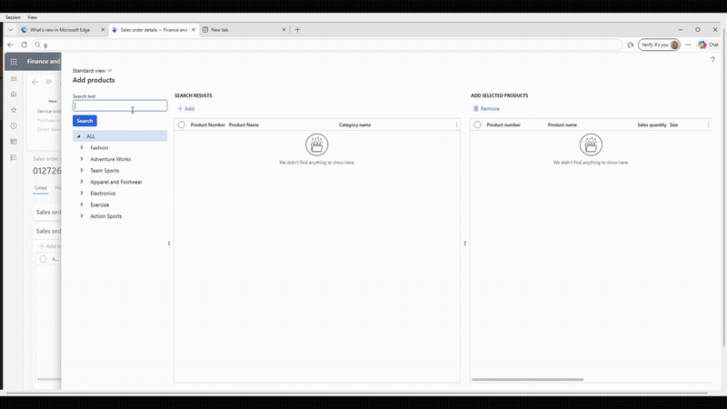
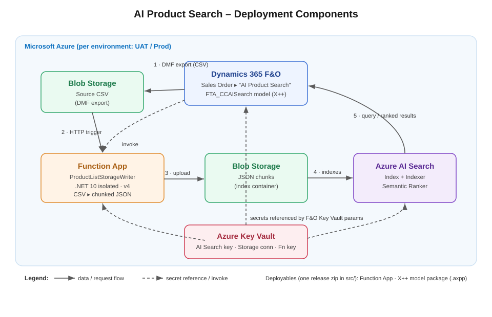

# CCAISearch – Azure AI Search for Item Search in Dynamics 365 F&O

Find products faster on the **Dynamics 365 Finance & Operations** sales order. Instead of the
standard SQL keyword lookup, item search uses **Azure AI Search** with its *Semantic Ranker*, so
users can type the way they talk and still get the right products.

> Developed by the **Microsoft FastTrack** team. See the [Disclaimer](#disclaimer).

**Current release: V8-20261116** · [Download](#download) · [Install](#install-in-3-steps) ·
[What's new](CHANGELOG.md)

---

## Table of contents

**For users**
- [Why use it](#why-use-it)
- [What it does](#what-it-does)
- [Download](#download)
- [Install in 3 steps](#install-in-3-steps)
- [Upgrade from an earlier version](#upgrade-from-an-earlier-version)
- [Previous versions](#previous-versions)
- [Disclaimer](#disclaimer)

**Technical details**
- [How it works](#how-it-works)
- [Security](#security)
- [Technology stack](#technology-stack)
- [Package contents](#package-contents)
- [License](#license)

---

## Why use it

**The problem.** The standard item search in D365 F&O matches keywords in SQL. Users must know
the exact item number or name, typos return nothing, and in large catalogs the search is slow
and adds load to the ERP database.

**The result with CCAISearch.**

| | Standard item search | With CCAISearch |
|---|---|---|
| **What users type** | Exact item number or name | Everyday words, e.g. "red running shoes size 42" |
| **Typos and synonyms** | No result | Still finds the right products |
| **Large catalogs** | Slower as the catalog grows | Results in seconds, ranked by relevance |
| **Variants and categories** | Separate lookups | One search, filter by color, size, style or category |
| **Load on the ERP database** | Every search hits SQL | Searches run in Azure AI Search |

**Why customers choose it**

- **Faster order entry** – sales and customer service staff find the right product while the
  customer is on the phone or at the counter.
- **Fewer wrong items** – relevance ranking puts the best match at the top, reducing order
  errors and returns.
- **Quicker onboarding** – new staff don't need to memorize item numbers.
- **Better ERP performance** – search traffic moves off the D365 database.
- **Low risk** – built as a separate add-on model; switch it off at any time with the
  **Enable Product Search** toggle on the **Azure AI Search parameters** form.
- **Your data stays in your tenant** – runs on your own Azure subscription, secured with Key
  Vault and managed identity.
- **Quick to set up, free source code** – about 30 minutes to install, MIT-licensed; you pay
  only for the Azure services you use.

## What it does

- **Find products in seconds** – even in very large catalogs.
- **Understands what users mean** – natural language, typos, synonyms and similar terms.
- **Search by variant** – color, size and style *(new in V8)*.
- **Browse by category** – see how many products are in each category and search inside one
  *(new in V8)*.
- **Lighter ERP** – searches go to Azure AI Search, not to the D365 database.
- **Enterprise-grade** – fully managed, secure and scalable Azure service.

## Download

Download **one zip** – it contains everything for the release.

| Release | Download |
|---|---|
| **V8-20261116** (latest) | [`CCAISearch_V8_20261116.zip`](src/CCAISearch_V8_20261116.zip) |

What's inside:

| File | Use it for |
|---|---|
| `FTA_CCAISearch_V8_20261116.axpp` | **New installation** of the D365 model |
| `FTA_CCAISearch_V8_20261116_Delta.axpp` | **Upgrade from V7** (only the changed objects) |
| `CCAISearch-Deploy-V8_20261116/` | The Azure Function App |
| `What-is-new-in-V8_20261116.pdf` | Summary of the changes in this release |

> Always deploy the Function App and the D365 model from the **same zip**, then run
> **Initialize index**.

## Install in 3 steps

Follow the guides **in order** (about 30 minutes in total):

| Step | Guide | What you do | Time |
|---|---|---|---|
| 1 | [Azure setup](docs/azure-setup.md) | Create Azure AI Search, Storage, Function App and Key Vault | ~15 min |
| 2 | [D365 model deployment](docs/fno-model-deployment.md) | Import the `.axpp` in Visual Studio, build and deploy | ~5 min |
| 3 | [F&O configuration](docs/fno-configuration.md) | Set the parameters, initialize the index, turn on the search | ~10 min |

You need an Azure subscription with **Contributor** or **Owner** rights and a D365 F&O
development environment to import the model.

## Upgrade from an earlier version

1. Check your current version in [`CHANGELOG.md`](CHANGELOG.md) and read what changed since then.
2. **From V7:** import the **Delta** `.axpp`. From an older version, import the full `.axpp`.
3. Redeploy the Function App from the same zip.
4. Run **Initialize index** in D365 so the index gets the new fields.

## Previous versions

Older releases are kept in [`src/archive/`](src/archive/). Each one is a single zip with
everything for that release: the model package, the Function App package, the What's new
document and the documentation **as it was for that version**. Use it when a customer runs an
older version.

| Release | Download | Contents |
|---|---|---|
| **V7-20260815** | [`CCAISearch_V7_20260815.zip`](src/archive/CCAISearch_V7_20260815.zip) | `FTA_CCAISearch_V7_20260815.axpp`, `CCAISearch-Deploy-v1.0.zip`, `What-is-new-in-V7_20260815.pdf`, `Docs-V7/` |

## Disclaimer

This solution is developed by the **Microsoft FastTrack** team. It is **not** covered under
product warranty and is **outside the scope of D365 support services**.

- Test thoroughly before deploying to production. If issues occur in production, turn the
  feature off on the **Azure AI Search parameters** form.
- Use **separate** Azure AI Search instances for Production and UAT – the environments may hold
  different data.
- Index only the fields you need; too many fields slows response times.
- The same approach can be extended to customer or order search.

---

# Technical details

## How it works

1. **Data export** – D365 product master data is exported as CSV (via DMF) to Azure Blob
   Storage.
2. **Data transformation** – The **Function App** (`ProductListStorageWriter`) downloads the
   CSV, parses it into records (turning the variant and category columns into index fields) and
   uploads them as JSON chunks to a destination blob container.
3. **Indexing** – **Azure AI Search** picks up the JSON chunks in near real time and builds a
   searchable product index with semantic ranking enabled.
4. **Search** – On the Sales Order form, the X++ form extension queries the Azure AI Search
   index directly (no SQL on the ERP), gets ranked results and displays them.

## Security

- Secrets (AI Search key, Storage connection string, Function key) are stored in
  **Azure Key Vault** and referenced through D365 Key Vault parameters.
- D365 sends only the blob **endpoint URL** (not a secret) to the Function App.
- The Function App writes to storage with its own **managed identity**
  (Storage Blob Data Contributor). No storage key or connection string is sent to or stored on
  the function.

## Technology stack

| Component | Technology | Purpose |
|---|---|---|
| **Cloud indexing** | Azure AI Search (Semantic Ranker) | Semantic search, re-ranking, NLP |
| **Data storage** | Azure Blob Storage | CSV source + JSON index data |
| **Transformation** | .NET 10 Azure Function (isolated) | CSV ▸ JSON chunking + upload |
| **Secrets management** | Azure Key Vault | Secure credential storage |
| **UI integration** | Dynamics 365 X++ (FTA model) | Sales Order search form extension |

## Package contents

| Folder / file | What it is |
|---|---|
| `src/CCAISearch_VN_YYYYMMDD.zip` | The current release (one zip) |
| `src/archive/` | Earlier releases, one self-contained zip each |
| `docs/` | Installation and configuration guides for the current release |
| `CHANGELOG.md` | Changes per release |

Inside the release zip, the `.axpp` files hold the X++ source of the **FTA** model (project
`FTA-AISearch-UDE`), and `CCAISearch-Deploy-VN_YYYYMMDD/` holds the .NET 10 source and
deployment files of the Function App.

## License

Released under the [MIT License](LICENSE).